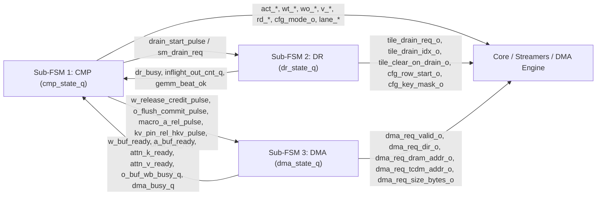
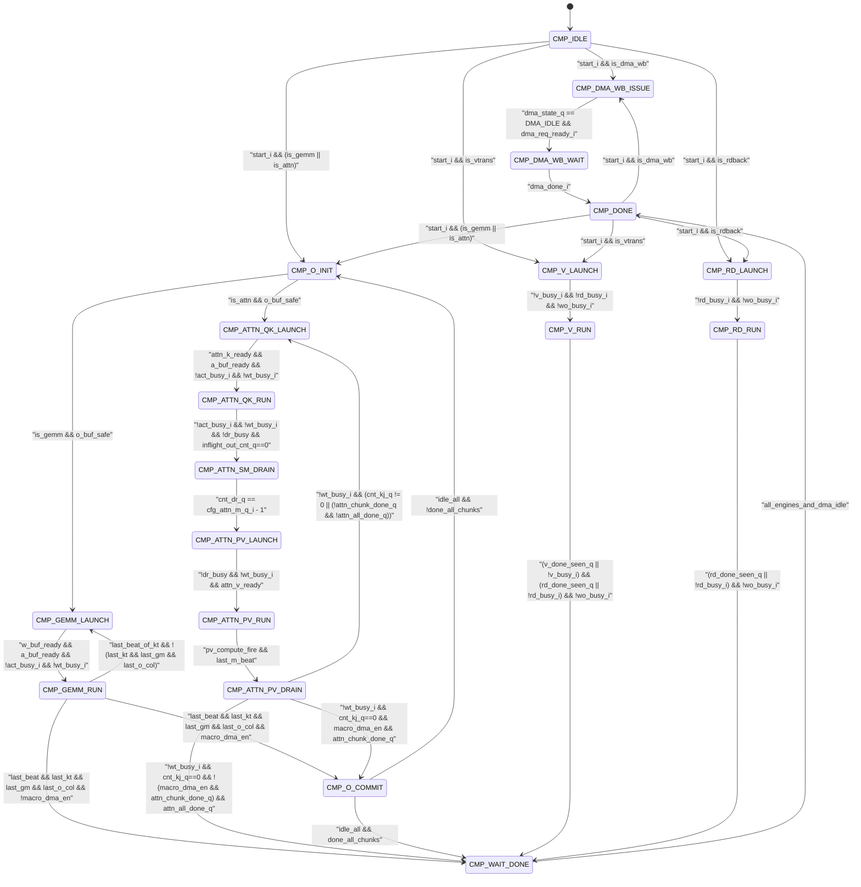
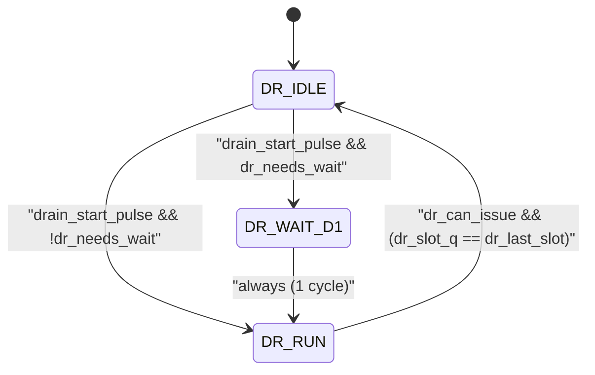
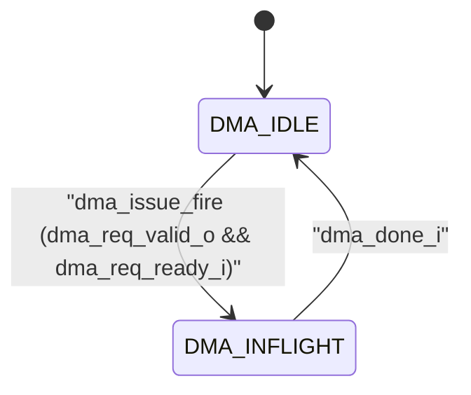

# Đặc tả Kiến trúc & Hoạt động Chi tiết 3 Sub-FSM trong `snax_llm_sequencer.sv`

Tài liệu này mô tả đầy đủ kiến trúc **Unified Hardware Sequencer** trong [snax_llm_sequencer.sv](file:///c:/Users/nguyen/Desktop/NPU_LOG/01_snax_llm_fp4_subsystem/snax_llm_sequencer.sv), bao gồm cơ chế phối hợp giữa **3 Sub-FSM chạy song song**, bảng mã hóa trạng thái, các tín hiệu bắt tay nội bộ, và hành động chi tiết tại từng state cho mọi chế độ vận hành: **4-Loop Output-Stationary GEMM**, **FlashAttention (Prefill & Decode)**, **Hardware V-Transpose (`op_mode = 2'b10`)**, **TCDM FP16 Readback + Requantize (`op_mode = 2'b11`)**, và **Standalone DMA Transfer (`cfg_dma_wb_i = 1`)**.

---

## Mục lục

1. [Tổng quan Kiến trúc 3 Sub-FSM & Bắt tay Nội bộ](#1-tổng-quan-kiến-trúc-3-sub-fsm--bắt-tay-nội-bộ)
2. [Phân loại Chế độ Vận hành (`Mode Classification`)](#2-phân-loại-chế-độ-vận-hành-mode-classification)
3. [Sub-FSM 1 (`cmp_state_q`): Compute, Attention, V-Transpose & Readback](#3-sub-fsm-1-cmp_state_q-compute-attention-v-transpose--readback)
   - [3.1. Bảng Mã hóa 19 Trạng thái](#31-bảng-mã-hóa-19-trạng-thái)
   - [3.2. Sơ đồ Chuyển Trạng thái Tổng thể](#32-sơ-đồ-chuyển-trạng-thái-tổng-thể)
   - [3.3. Mô tả Chi tiết Hành động từng State](#33-mô-tả-chi-tiết-hành-động-từng-state)
4. [Sub-FSM 2 (`dr_state_q`): Background Drain & WAR-Hazard Guard](#4-sub-fsm-2-dr_state_q-background-drain--war-hazard-guard)
5. [Sub-FSM 3 (`dma_state_q`): DMA Arbiter, Ring Buffer, Ping-Pong A/O & KV-Pin](#5-sub-fsm-3-dma_state_q-dma-arbiter-ring-buffer-ping-pong-ao--kv-pin)
6. [Timeline Thực thi End-to-End (Prefill vs Decode)](#6-timeline-thực-thi-end-to-end-prefill-vs-decode)
7. [Bảng Tóm tắt Toàn bộ Trạng thái Hệ thống](#7-bảng-tóm-tắt-toàn-bộ-trạng-thái-hệ-thống)

---

## 1. Tổng quan Kiến trúc 3 Sub-FSM & Bắt tay Nội bộ

Thay vì dùng một FSM đơn khối vừa điều phối compute vừa chờ DMA và chờ drain output (dễ gây bubble mỗi K-tile hoặc deadlock khi `K_tiles > 1`), `snax_llm_sequencer` tách luồng điều khiển thành **3 Sub-FSM bất đồng bộ có cấu trúc** chạy song song trên cùng clock `clk`:

| Sub-FSM | Thanh ghi trạng thái | Số state | Vai trò chính |
| :--- | :--- | :---: | :--- |
| **Sub-FSM 1 (`[CMP]`)** | `cmp_state_q` (`logic [4:0]`) | 19 | Điều phối vòng lặp GEMM 4-Loop, FlashAttention QK/SM/PV, Hardware V-Transpose, Readback, và Standalone DMA WB |
| **Sub-FSM 2 (`[DR]`)** | `dr_state_q` (`logic [1:0]`) | 3 | Xả nền (`background drain`) vùng Latch O (`Slots 0..15` ở GEMM hoặc `0..M_Q-1` ở Attention), quản lý 4 pipe credit & chống ghi đè WAR |
| **Sub-FSM 3 (`[DMA]`)** | `dma_state_q` (`logic`) | 2 | Trọng tài 4 client DMA (`DMA_TAG_WB`, `DMA_TAG_O`, `DMA_TAG_A`, `DMA_TAG_W`), quản lý Ring 4 slot, Ping-Pong A/O và GQA KV-Pin |



### Danh sách Tín hiệu Bắt tay Giữa các Sub-FSM

1. **Giao tiếp `[CMP] <-> [DR]`:**
   - `drain_start_pulse`: Xung 1 chu kỳ từ `[CMP]` (`CMP_GEMM_RUN` tại `last_kt && last_gk && last_gbeat`, hoặc `CMP_ATTN_PV_DRAIN` tại `cnt_kj_q == 16'd0 && !wt_busy_i`) để kích hoạt `[DR]` bắt đầu xả Latch O ra `u_write_out`.
   - `sm_drain_req`, `sm_drain_idx`, `sm_row_start`: `[CMP]` ở state `CMP_ATTN_SM_DRAIN` trực tiếp chiếm quyền Port B (sau khi đã chờ `!dr_busy && inflight_out_cnt_q == 0`) để xả `Slots 8..15` vào bộ Softmax Requantizer.
   - `dr_busy` (`dr_state_q != DR_IDLE`) và `inflight_out_cnt_q` (`0..4`): Cho `[CMP]` biết đường xả `final_normalizer` còn dữ liệu chưa tới `u_write_out`.
   - `gemm_beat_ok`: Tín hiệu bảo vệ Read-Before-Write (WAR). Khi `[DR]` đang xả song song với tile mới ở `CMP_GEMM_RUN`, beat `cnt_gbeat_q` chỉ được phép ghi vào Latch khi slot đó đã được xả (`cnt_gbeat_q < dr_slot_q`).

2. **Giao tiếp `[CMP] <-> [DMA]`:**
   - `w_buf_ready`, `attn_k_ready`, `attn_v_ready`: `[DMA]` báo cho `[CMP]` rằng dữ liệu `W` / `K` / `V` cho lượt hiện tại đã nằm an toàn trên TCDM.
   - `a_buf_ready`: Khi `macro_dma_en = 1`, `[DMA]` báo buffer Ping-Pong `a_buf_ready_q[a_cmp_rd_sel_q]` đã nạp xong từ DRAM.
   - `w_release_credit_pulse`: `[CMP]` báo đã dùng xong slot Ring hiện tại, cộng trả `w_free_credits_q`, giảm `w_ready_tiles_q`, và dịch `ring_rd_ptr_q`.
   - `kv_pin_rel_hkv_pulse`: Ở chế độ `attn_kv_pin_en = 1`, khi toàn bộ GQA query heads thuộc nhóm `h_kv` hoàn tất xong, `[CMP]` xả `pin_active_hkv_q` sang `h_kv + 1` và reset `k_pinned_cnt_q` / `v_pinned_cnt_q`.
   - `o_flush_commit_pulse` & `macro_a_rel_pulse`: Khi kết thúc 1 Macro O-Chunk ở `CMP_O_COMMIT`, `[CMP]` giao buffer `o_cmp_sel_q` cho `[DMA]` ghi ngược ra DRAM (`o_buf_wb_busy_q[o_cmp_sel_q] <= 1'b1`), đồng thời giải phóng buffer `A` (`a_buf_ready_q[a_cmp_rd_sel_q] <= 1'b0`) khi tới `last_o_chunk` (GEMM) hoặc mọi chunk (Attention).
   - `dma_wb_req`: Kích hoạt khi `[CMP]` ở `CMP_DMA_WB_ISSUE` và `dma_state_q == DMA_IDLE`.

---

## 2. Phân loại Chế độ Vận hành (`Mode Classification`)

Khi xung `start_i` kích hoạt, bộ giải mã tổ hợp xác định chế độ từ `cfg_dma_wb_i` và `cfg_op_mode_i`:

| Biểu thức giải mã | Điều kiện cấu hình | Ý nghĩa & Luồng chạy |
| :--- | :--- | :--- |
| **`is_dma_wb`** | `cfg_dma_wb_i == 1'b1` | Chuyển DMA đơn lẻ DRAM <-> TCDM (`CMP_DMA_WB_ISSUE -> CMP_DMA_WB_WAIT -> CMP_DONE`) |
| **`is_gemm`** | `!cfg_dma_wb_i && (cfg_op_mode_i == 2'b00)` | 4-Loop Output-Stationary GEMM (Prefill `M = 16x` hoặc Decode `cfg_gemm_decode_i = 1`), hỗ trợ Ring `W` & Macro-DMA `A/O` |
| **`is_attn`** | `!cfg_dma_wb_i && (cfg_op_mode_i == 2'b01)` | FlashAttention Exp-Free Online Softmax, hỗ trợ GQA, Causal Mask, Ring `K/V`, KV-Pinning & Macro-DMA `Q/O` |
| **`is_vtrans`** | `!cfg_dma_wb_i && (cfg_op_mode_i == 2'b10)` | Hardware V-Transpose: đọc FP16 từ TCDM (`u_stream_rd_fp16`) -> lượng tử hóa + hoán vị (`u_v_quant_path`) -> ghi FP4 packed ra TCDM (`u_write_out` mode `2'd2`) |
| **`is_rdback`** | `!cfg_dma_wb_i && (cfg_op_mode_i == 2'b11)` | Đọc ngược FP16 từ TCDM qua `u_stream_rd_fp16` -> lượng tử hóa hoặc reshape 4D qua `u_write_out` (`mode 2'd0` hoặc `2'd3`) |

Các cờ chế độ DMA mở rộng:
- `macro_dma_en = cfg_gemm_macro_dma_i && cfg_enable_dma_i && (is_gemm || is_attn)`: Bật Macro-Tiling Ping-Pong cho `A/Q` và `O` khi ma trận lớn hơn TCDM.
- `attn_kv_pin_en = cfg_attn_kv_pin_i && cfg_enable_dma_i && is_attn`: Ghim toàn bộ `K, V` của 1 `h_kv` trên TCDM để tái sử dụng cho mọi `Q_tile` và mọi `h_grp` trong nhóm GQA.
- `w_ring_reuse_active = is_gemm && cfg_enable_dma_i && (cfg_gemm_k_tiles_m1_i == 8'd0)`: Khi `K_TILES == 1`, mỗi tile `W[n, 0]` trong Ring slot được dùng lại xuyên suốt toàn bộ `cur_m_sub` hàng token trước khi nhả credit.

---

## 3. Sub-FSM 1 (`cmp_state_q`): Compute, Attention, V-Transpose & Readback

### 3.1. Bảng Mã hóa 19 Trạng thái

| Tên State (`cmp_state_t`) | Mã 5-bit | Nhóm chức năng |
| :--- | :---: | :--- |
| `CMP_IDLE` | `5'd0` | Trạng thái nghỉ chờ `start_i` |
| `CMP_O_INIT` | `5'd1` | Chuẩn bị buffer O & phát `wo_start_o` / `v_start_o` cho cả chunk |
| `CMP_GEMM_LAUNCH` | `5'd2` | Kích `act_start_o` & `wt_start_o` cho 1 lát `K_BLOCKS` của GEMM |
| `CMP_GEMM_RUN` | `5'd3` | Bơm từng beat GEMM vào MAC/Latch, trả credit `W`, phát `drain_start_pulse` |
| `CMP_ATTN_QK_LAUNCH` | `5'd4` | Kích `act_start_o` (`Q`) & `wt_start_o` (`K`) cho khối QK |
| `CMP_ATTN_QK_RUN` | `5'd5` | Tích lũy điểm `S = Q × K^T` vào `Slots 8..15` |
| `CMP_ATTN_SM_DRAIN` | `5'd6` | Chiếm Port B xả `Slots 8..15` kèm causal mask qua Softmax vào `p_fifo` |
| `CMP_ATTN_PV_LAUNCH` | `5'd7` | Chờ `!dr_busy && attn_v_ready`, kích `wt_start_o` đọc `V` (`1` block lặp `M_Q` lần) |
| `CMP_ATTN_PV_RUN` | `5'd8` | Tích lũy `P × V` vào `Slots 0..7` qua Rescaler, cập nhật chỉ số Attention |
| `CMP_ATTN_PV_DRAIN` | `5'd9` | Rút nốt `wt_stream`, nhả credit `K/V` hoặc `h_kv`, phát `drain_start_pulse` cuối `kj` |
| `CMP_O_COMMIT` | `5'd10` | Giao buffer `O` hoàn chỉnh cho `[DMA]` ghi ra DRAM, đảo Ping-Pong A/O |
| `CMP_V_LAUNCH` | `5'd11` | Khởi chạy đồng thời `u_stream_rd_fp16` + `u_v_quant_path` (V-Transpose) |
| `CMP_V_RUN` | `5'd12` | Giữ nguyên descriptor `rd_*` & `wo_*`, chờ hoàn tất V-Transpose |
| `CMP_RD_LAUNCH` | `5'd13` | Khởi chạy `u_stream_rd_fp16` + `u_write_out` cho Readback/Reshape |
| `CMP_RD_RUN` | `5'd14` | Giữ descriptor `rd_*` & `wo_*`, chờ hoàn tất Readback |
| `CMP_DMA_WB_ISSUE` | `5'd15` | Phát yêu cầu `DMA_TAG_WB` đơn lẻ và chờ `dma_req_ready_i` |
| `CMP_DMA_WB_WAIT` | `5'd16` | Chờ `dma_done_i` cho tác vụ DMA đơn lẻ |
| `CMP_WAIT_DONE` | `5'd17` | Hàng rào đồng bộ chờ `[DR]`, Output pipeline, Streamers & `[DMA]` đều rảnh |
| `CMP_DONE` | `5'd18` | Báo hoàn tất `done_o` (khi toàn bộ phụ trợ rảnh), sẵn sàng nhận `start_i` kế tiếp |

---

### 3.2. Sơ đồ Chuyển Trạng thái Tổng thể



---

### 3.3. Mô tả Chi tiết Hành động từng State

> **Lưu ý về giá trị mặc định tổ hợp (`always_comb`) trong Sub-FSM 1:**
> - Toàn bộ xung trigger (`drain_start_pulse`, `w_release_credit_pulse`, `o_flush_commit_pulse`, `macro_a_rel_pulse`, `kv_pin_rel_hkv_pulse`, `sm_drain_req`, `act_start_o`, `wt_start_o`, `wo_start_o`, `v_start_o`, `rd_start_o`, `act_ready_o`, `wt_ready_o`, `lane_valid_o`) mặc định bằng `0`.
> - **`cfg_mode_o`** mặc định bằng **`is_attn ? 2'b10 : 2'b00`** — không bao giờ kéo xuống `2'b00` trong suốt phiên FlashAttention vì bên trong Core `norm_bypass_inv_l = (cfg_mode_i == 2'b00)`.
> - **`cfg_enable_slq_o`** luôn bằng `1'b1`.

---

#### State 0: `CMP_IDLE` (`5'd0`)
- **Mục đích:** Nghỉ sau reset, chờ xung `start_i`.
- **Hành động tổ hợp:** Không phát bất kỳ xung `*_start_o` hay `lane_valid_o` nào (`busy_o = 0`, `done_o = 0`).
- **Hành động thanh ghi khi có `start_i`:** Reset toàn bộ bộ đếm GEMM (`cnt_gn_q`, `cnt_gm_q`, `cnt_kt_q`, `cnt_gk_q`, `cnt_gbeat_q`), Attention (`cnt_h_q`, `cnt_hkv_q`, `cnt_hgrp_q`, `cnt_qi_q`, `cnt_dvi_q`, `cnt_kj_q`, `cnt_m_q`, `cnt_dr_q`, `causal_q_idx_q <= 0`, `kv_first_q <= 1`, `attn_chunk_done_q <= 0`, `attn_all_done_q <= 0`, `kv_pin_hkv_end_q <= 0`), Macro Ping-Pong (`cmp_m_base_q`, `o_col_start_q`, `a_cmp_rd_sel_q`, `o_cmp_sel_q`), và cờ `v_done_seen_q`, `rd_done_seen_q` về `0`. Đồng thời Sub-FSM 3 nạp `dma_w_pending_q <= cfg_enable_dma_i && (is_gemm || is_attn)` và `dma_a_pending_q <= macro_dma_en`.
- **Điều kiện chuyển state:**
  - `start_i && is_dma_wb` $\rightarrow$ `CMP_DMA_WB_ISSUE`
  - `start_i && is_vtrans` $\rightarrow$ `CMP_V_LAUNCH`
  - `start_i && is_rdback` $\rightarrow$ `CMP_RD_LAUNCH`
  - `start_i` (với `is_gemm` hoặc `is_attn`) $\rightarrow$ `CMP_O_INIT`

---

#### State 1: `CMP_O_INIT` (`5'd1`)
- **Mục đích:** Khởi chạy kênh ghi output (`u_write_out` hoặc `u_v_quant_path`) **1 lần duy nhất cho toàn bộ một O-Chunk** (`cur_m_sub × cur_o_cols` ở GEMM, hoặc `1` hoặc `H` heads × `cur_m_sub × dv_tiles` ở Attention), chấm dứt lỗi treo `v_busy_i` ở mỗi K-tile của thiết kế cũ.
- **Điều kiện an toàn trước khi phát lệnh (`o_buf_safe`):**
  - Nếu `macro_dma_en == 1` (cả GEMM & Attention): phải thỏa đồng thời `!wo_busy_i && !v_busy_i && !dr_busy && (inflight_out_cnt_q == 4'd0) && !o_buf_wb_busy_q[o_cmp_sel_q]`, đảm bảo buffer Ping-Pong `O[o_cmp_sel_q]` đã được DMA ghi hết ra DRAM ở lượt trước rồi mới ghi đè.
  - Nếu `macro_dma_en == 0`: với GEMM chạy ngay không cần chờ; với Attention chờ `!wo_busy_i`.
- **Hành động tổ hợp khi thỏa điều kiện:**
  - **`is_gemm`:** Đặt `wo_base_o = o_cmp_base`. Nếu `cfg_out_mode_i == 2'd3` (Fused V-Transpose): kích **`v_start_o = 1'b1`** (không kích `wo_start_o`), `wo_mode_o = 2'd2`, `wo_num_vectors_o = 16`, `wo_line_stride_o = 16`, `wo_num_batches_o = cur_m_sub * cur_o_cols`, `wo_batch_stride_o = 32'h200`. Nếu `cfg_out_mode_i != 2'd3`: kích **`wo_start_o = 1'b1`** với mapping mode:
    - `2'd0`: `wo_mode_o = 2'd1`; nếu `cfg_out_bank_layout_i && !cfg_gemm_decode_i` dùng batch 16-bank (`wo_num_vectors_o = 16`, `wo_line_stride_o = 16`, `wo_num_batches_o = cur_m_sub * cur_o_cols`, `wo_batch_stride_o = 32'h800`), ngược lại flat `cur_o_cols` (Decode) hoặc `cur_m_sub * cur_o_cols * 16` (Prefill).
    - `2'd1`: `wo_mode_o = 2'd0` (ghi 16-bit FP16 raw hoặc mode phụ), `wo_num_vectors_o = decode ? cur_o_cols : cur_m_sub * cur_o_cols * 16`.
    - `2'd2`: `wo_mode_o = 2'd2` (repack), `wo_num_vectors_o = decode ? 1 : 16`, `wo_line_stride_o = 16`, `wo_num_batches_o = cur_m_sub * cur_o_cols`, `wo_batch_stride_o = 32'h200`.
  - **`is_attn`:** Kích **`wo_start_o = 1'b1`**, `wo_base_o = o_cmp_base`.
    - Nếu `cfg_out_mode_i == 2'd2` (4D TCDM layout): `wo_mode_o = 2'd3`, cấu hình đủ 4 vòng lặp `(vec = cfg_attn_m_q_i, batch = cfg_attn_dv_tiles_i, dim2 = cur_m_sub, dim3 = macro_dma_en ? 1 : cfg_attn_h_i)` để tự động sắp xếp O liên tiếp theo `[H_macro][Q_macro][M_Q][D_V]`.
    - Ngược lại (`2'd0` / `2'd1`): ghi tuyến tính 1D (`wo_mode_o = (cfg_out_mode_i == 2'd1) ? 2'd0 : 2'd1`), `wo_num_vectors_o = (macro_dma_en ? 1 : cfg_attn_h_i) * cur_m_sub * cfg_attn_dv_tiles_i * cfg_attn_m_q_i`, `wo_line_stride_o = 32'h200`.
- **Chuyển state:** `is_gemm` $\rightarrow$ `CMP_GEMM_LAUNCH`; `is_attn` $\rightarrow$ `CMP_ATTN_QK_LAUNCH`.

---

#### State 2: `CMP_GEMM_LAUNCH` (`5'd2`)
- **Mục đích:** Khởi chạy 2 streamer `u_act_stream` (`A[cnt_gm_q, cnt_kt_q]`) và `u_wt_stream` (`W[abs_gn, cnt_kt_q]`) cho 1 lát `K_BLOCKS` của GEMM 4-Loop.
- **Điều kiện chờ:** `w_buf_ready && a_buf_ready && !act_busy_i && !wt_busy_i`.
  - Ở trạng thái này `cnt_gk_q` luôn đã reset về `0`, nên địa chỉ gốc `act_tile_tcdm_addr` và `core_wt_addr` đều trỏ vào K-block đầu tiên của lát `cnt_kt_q`.
- **Hành động tổ hợp khi sẵn sàng:** Phát đồng thời **`act_start_o = 1'b1`** và **`wt_start_o = 1'b1`**:
  - `act_base_o = act_tile_tcdm_addr`, `act_k_blocks_o = cfg_gemm_k_blocks_i`, `act_k_stride_o = 32'h200`, `act_tokens_o = cfg_gemm_decode_i ? 1 : 16`, `act_token_stride_o = cfg_act_bank_layout_i ? 32'h10 : (total_k_blocks * 32'h200)`.
  - `wt_base_o = core_wt_addr` (từ Ring slot `ring_rd_ptr_q` nếu DMA bật, hoặc địa chỉ preload), `wt_repeat_o = decode ? 1 : 16`, `wt_k_blocks_o = cfg_gemm_k_blocks_i`, `wt_k_stride_o = 32'h200`, `wt_num_tiles_o = 1`.
- **Chuyển state:** $\rightarrow$ `CMP_GEMM_RUN`.

---

#### State 3: `CMP_GEMM_RUN` (`5'd3`)
- **Mục đích:** Đẩy dữ liệu từng beat từ 2 streamer vào mảng MAC/Latch trong Core, quản lý tích lũy `K_TILES`, nhả slot Ring cho `[DMA]`, và phát `drain_start_pulse` cho `[DR]`.
- **Điều kiện beat hợp lệ:** `gemm_compute_fire = act_valid_i && (&wt_valid_i) && gemm_beat_ok`.
  - `gemm_beat_ok` chỉ chặn beat khi `[DR]` đang bận xả Latch O của tile trước mà `cnt_gbeat_q >= dr_slot_q` (tránh ghi đè Latch slot chưa kịp đọc ra).
- **Hành động tổ hợp khi `gemm_compute_fire == 1`:**
  - `lane_valid_o = 16'hFFFF`, `lane_acc_idx_o = cnt_gbeat_q` (`0` ở Decode, `0..15` ở Prefill).
  - `act_ready_o = 1'b1`, `wt_ready_o = 16'hFFFF`.
  - Nếu đang ở beat cuối cùng của 1 lát `K_BLOCKS` (`last_gbeat && last_gk`):
    - **`w_release_credit_pulse = cfg_enable_dma_i && (w_ring_reuse_active ? last_gm : 1'b1)`**: Khi `K_TILES == 1`, giữ lại slot `W[n, 0]` trong Ring cho toàn bộ `cnt_gm_q = 0..cur_m_sub-1` và chỉ nhả credit tại `last_gm`; khi `K_TILES > 1`, nhả sau mỗi lát `(n, m, kt)`.
    - Nếu **`last_kt`**: phát **`drain_start_pulse = 1'b1`** kích `[DR]` bắt đầu xả Latch `O` vừa tính xong chạy ngầm ở background trong khi `[CMP]` lập tức chuyển sang tính tile kế tiếp!
- **Cập nhật bộ đếm (từ trong ra ngoài):**
  `cnt_gbeat_q` (`0` ở Decode / `0..15` ở Prefill) $\rightarrow$ `cnt_gk_q` (`0..K_BLOCKS-1`) $\rightarrow$ `cnt_kt_q` (`0..K_TILES-1`) $\rightarrow$ `cnt_gm_q` (`0..cur_m_sub-1`) $\rightarrow$ `cnt_gn_q` (`0..cur_o_cols-1`).
- **Chuyển state (khi `gemm_compute_fire && last_gbeat && last_gk`):**
  - Nếu `last_kt && last_gm && last_o_col`: sang `CMP_O_COMMIT` (nếu `macro_dma_en`) hoặc `CMP_WAIT_DONE` (nếu `!macro_dma_en`).
  - Ngược lại: quay về `CMP_GEMM_LAUNCH` cho bước `(kt / gm / gn)` tiếp theo.

---

#### State 4: `CMP_ATTN_QK_LAUNCH` (`5'd4`)
- **Mục đích:** Kích hoạt tính tích vô hướng $S = Q[q_i] \times K[k_j]^T$ cho 1 cặp tile `(qi, kj)` của Attention.
- **Điều kiện chờ:** `attn_k_ready && a_buf_ready && !act_busy_i && !wt_busy_i`.
  - Khi đang chồng lấn (`overlap`) với background `O` drain của lượt `dvi` trước, `QK_LAUNCH` vẫn chạy song song bình thường miễn `K` và `Q` sẵn sàng.
- **Hành động tổ hợp:**
  - `cfg_mode_o = 2'b01` (chọn đường `ext_act` cho phép nhân $Q \times K^T$).
  - Khi đủ điều kiện chờ, phát **`wt_start_o = 1'b1`** (`wt_base_o = attn_k_addr`, `wt_repeat_o = cfg_attn_m_q_i`, `wt_k_blocks_o = cfg_attn_k_blocks_i`, `wt_k_stride_o = 32'h200`) và **`act_start_o = 1'b1`** (`act_base_o = attn_q_addr`, `act_tokens_o = cfg_attn_m_q_i`, `act_token_stride_o = cfg_attn_k_blocks_i * 32'h200`, `act_k_blocks_o = cfg_attn_k_blocks_i`, `act_k_stride_o = 32'h200`).
- **Hành động thanh ghi:** Đặt `cnt_m_q <= 4'd0` và `causal_q_idx_q <= 4'd0`.
- **Chuyển state:** $\rightarrow$ `CMP_ATTN_QK_RUN`.

---

#### State 5: `CMP_ATTN_QK_RUN` (`5'd5`)
- **Mục đích:** Đưa từng vector `(q_row, k_block)` của Q và K vào Core để tích lũy $S$ vào **Vùng S của Latch (`Slots 8..15`)**.
- **Hành động tổ hợp:**
  - `cfg_mode_o = 2'b01`.
  - Khi `qk_compute_fire` (`act_valid_i && (&wt_valid_i)`): `lane_valid_o = 16'hFFFF`, **`lane_acc_idx_o = {1'b1, cnt_m_q[2:0]}`** (ghi vào Latch `8..15`), `act_ready_o = 1'b1`, `wt_ready_o = 16'hFFFF`.
- **Hành động thanh ghi:** Tăng `cnt_m_q` modulo `cfg_attn_m_q_i` sau mỗi `qk_compute_fire`. Tại điều kiện thoát state, reset `cnt_dr_q <= 4'd0`.
- **Chuyển state:** Khi `!act_busy_i && !wt_busy_i && !dr_busy && (inflight_out_cnt_q == 4'd0)` $\rightarrow$ `CMP_ATTN_SM_DRAIN`.
  - *Giải thích barrier:* Phải chờ `!dr_busy && inflight_out_cnt_q == 0` để chắc chắn luồng background drain Latch O của lượt `dvi` trước đã hoàn toàn rút khỏi Port B và pipeline `final_normalizer` trước khi `CMP_ATTN_SM_DRAIN` chiếm Port B.

---

#### State 6: `CMP_ATTN_SM_DRAIN` (`5'd6`)
- **Mục đích:** Xả tuần tự `M_Q` hàng điểm `S` từ `Slots 8..15` qua khối `LOG2E` và `u_softmax_requantizer` để đẩy các vector xác suất $P$ (và hệ số rescale `alpha`) vào `p_fifo` nội bộ Core.
- **Hành động tổ hợp:**
  - `cfg_mode_o = 2'b01`.
  - **`sm_drain_req = 1'b1`** (mux Port B ở Section 2 chọn đường Softmax Drain và kéo `tile_clear_on_drain_o = 1'b1`).
  - **`sm_drain_idx = {1'b1, cnt_dr_q[2:0]}`** (xả `Slot 8 + cnt_dr_q`).
  - **`sm_row_start = kv_first_q`** (`1` chỉ khi `cnt_kj_q == 0`, báo Online Softmax reset `m_i, l_i`).
  - **`cfg_key_mask_o = auto_causal_mask`** (sinh mask 16-bit dựa trên `causal_q_idx_q` và vị trí query tuyệt đối `cmp_m_base_q + cnt_qi_q`; bằng `16'hFFFF` nếu `cfg_is_causal_i == 0`).
- **Hành động thanh ghi:** Mỗi chu kỳ tăng `cnt_dr_q <= cnt_dr_q + 4'd1` và cập nhật `causal_q_idx_q <= cnt_dr_q` (khớp độ trễ 1 chu kỳ từ Port B sang stage Softmax).
- **Chuyển state:** Khi `cnt_dr_q == (cfg_attn_m_q_i - 4'd1)` $\rightarrow$ `CMP_ATTN_PV_LAUNCH`.

---

#### State 7: `CMP_ATTN_PV_LAUNCH` (`5'd7`)
- **Mục đích:** Chờ pipeline sau `SM_DRAIN` (nếu có `dr_busy`) và chờ tile `V[dvi, kj]` sẵn sàng trên TCDM để kích `u_wt_stream` nạp `V`.
- **Hành động tổ hợp:**
  - Giữ `cfg_mode_o = 2'b01` để hoàn tất phần đuôi Softmax.
  - Khi `!dr_busy && !wt_busy_i && attn_v_ready`: phát **`wt_start_o = 1'b1`** (`wt_base_o = attn_v_addr`, **`wt_repeat_o = cfg_attn_m_q_i`**, **`wt_k_blocks_o = 32'd1`**, `wt_k_stride_o = 32'd0`). Do mỗi cột/hàng 16 phần tử `V` dùng chung cho cả `M_Q` hàng `P`, `wt_stream` đọc 1 block và lặp lại `M_Q` lần.
- **Hành động thanh ghi:** Reset `cnt_m_q <= 4'd0`.
- **Chuyển state:** Khi `!dr_busy && !wt_busy_i && attn_v_ready` $\rightarrow$ `CMP_ATTN_PV_RUN`.

---

#### State 8: `CMP_ATTN_PV_RUN` (`5'd8`)
- **Mục đích:** Nhân xác suất $P$ (từ `p_fifo`) với `V` (từ `wt_stream`), đồng thời rescale tích lũy cũ $O_{old} \times \alpha$ và cộng dồn vào **Vùng O của Latch (`Slots 0..7`)**.
- **Hành động tổ hợp:**
  - **`cfg_mode_o = 2'b10`** (chuyển Core sang pha PV / Rescaling).
  - Khi `pv_compute_fire` (`!p_fifo_empty_i && (&wt_valid_i)`): `lane_valid_o = 16'hFFFF`, **`lane_acc_idx_o = {1'b0, cnt_m_q[2:0]}`** (ghi vào Latch `0..7`), `wt_ready_o = 16'hFFFF`.
- **Hành động thanh ghi:**
  - Nếu chưa tới beat cuối (`!last_m_beat`): `cnt_m_q <= cnt_m_q + 4'd1`.
  - Khi `pv_compute_fire && last_m_beat`: reset `cnt_m_q <= 4'd0` và tăng bộ đếm vòng lặp Attention:
    - Nếu `!last_kj`: tăng `cnt_kj_q <= cnt_kj_q + 16'd1`.
    - Nếu `last_kj`: reset `cnt_kj_q <= 16'd0`; cập nhật **`kv_pin_hkv_end_q <= attn_kv_pin_en && last_dvi && last_qi && is_last_h_of_hkv`**.
      - Nếu `macro_dma_en == 1`: hết `dvi` tăng `cnt_qi_q`; nếu `last_dvi && last_qi` thì bật **`attn_chunk_done_q <= 1'b1`** và **`attn_all_done_q <= last_h && last_macro_m`** (riêng `cnt_h_q/hkv_q/hgrp_q` sẽ do `CMP_O_COMMIT` cập nhật).
      - Nếu `macro_dma_en == 0`: tự tăng tuần tự `cnt_dvi_q` $\rightarrow$ `cnt_qi_q` $\rightarrow$ `(cnt_h_q, cnt_hkv_q, cnt_hgrp_q)` và gán `attn_all_done_q <= last_dvi && last_qi && last_h`.
- **Chuyển state:** Khi `pv_compute_fire && last_m_beat` $\rightarrow$ `CMP_ATTN_PV_DRAIN`.

---

#### State 9: `CMP_ATTN_PV_DRAIN` (`5'd9`)
- **Mục đích:** Dọn sạch bất kỳ beat dư nào của `u_wt_stream` (`wt_ready_o = 16'hFFFF`), giải phóng slot Ring / KV-Pin, và phát lệnh xả `O` nền nếu vừa xong toàn bộ chiều `KV` (`cnt_kj_q == 0`).
- **Hành động tổ hợp:**
  - `cfg_mode_o = 2'b10`, `wt_ready_o = 16'hFFFF`.
  - Khi `!wt_busy_i`:
    - `w_release_credit_pulse = cfg_enable_dma_i && !attn_kv_pin_en` (nhả slot Ring chứa `(K, V)[kj]`).
    - `kv_pin_rel_hkv_pulse = attn_kv_pin_en && kv_pin_hkv_end_q` (nhả bộ đếm pin của `h_kv` hiện tại để `[DMA]` nạp tiếp `h_kv + 1`).
    - Nếu `cnt_kj_q == 16'd0` (vừa khép kín `kj = KV_TILES - 1`): phát **`drain_start_pulse = 1'b1`** kích `[DR]` xả `Slots 0..M_Q-1` ra TCDM ở background!
- **Hành động thanh ghi khi `!wt_busy_i`:** `kv_first_q <= (cnt_kj_q == 16'd0)`, `kv_pin_hkv_end_q <= 1'b0`.
- **Chuyển state khi `!wt_busy_i`:**
  - Nếu `cnt_kj_q == 16'd0 && macro_dma_en && attn_chunk_done_q` $\rightarrow$ `CMP_O_COMMIT`
  - Ngược lại nếu `cnt_kj_q == 16'd0 && attn_all_done_q` $\rightarrow$ `CMP_WAIT_DONE`
  - Ngược lại $\rightarrow$ `CMP_ATTN_QK_LAUNCH`

---

#### State 10: `CMP_O_COMMIT` (`5'd10`)
- **Mục đích:** Chỉ dùng khi `macro_dma_en == 1`. Đảm bảo toàn bộ vector của Ping-Pong O-Chunk hiện tại đã được ghi xong vào `o_cmp_base` trên TCDM, sau đó bàn giao buffer này cho `[DMA]` xả ra DRAM đồng thời xoay bank Ping-Pong cho chunk kế tiếp.
- **Điều kiện chờ:** `!wo_busy_i && !dr_busy && (inflight_out_cnt_q == 4'd0) && !v_busy_i && !act_busy_i && !wt_busy_i`.
- **Hành động tổ hợp khi thỏa điều kiện:**
  - **`o_flush_commit_pulse = 1'b1`**: Giao buffer `o_cmp_sel_q` cho `[DMA]` (`o_buf_wb_busy_q[o_cmp_sel_q] <= 1'b1`) kèm địa chỉ DRAM đích `o_buf_wb_dram_q[o_cmp_sel_q]` và số byte `o_buf_wb_bytes_q[o_cmp_sel_q]`.
  - **`macro_a_rel_pulse = is_attn ? 1'b1 : last_o_chunk`**: Ở Attention, mọi chunk đều giải phóng `a_buf_ready_q[a_cmp_rd_sel_q]`; ở GEMM, chỉ giải phóng buffer `A` khi tính hết mọi O-chunk theo chiều `N` (`last_o_chunk == 1`), nhờ đó `A` được tái sử dụng cho nhiều `O_chunk` liên tiếp.
- **Hành động thanh ghi khi `o_flush_commit_pulse`:**
  - Đảo `o_cmp_sel_q <= ~o_cmp_sel_q`.
  - Nếu `is_gemm`: nếu `!last_o_chunk` thì tăng `o_col_start_q <= o_col_start_q + cur_o_cols`; ngược lại reset `o_col_start_q <= 0`, đảo `a_cmp_rd_sel_q <= ~a_cmp_rd_sel_q`, và cập nhật `cmp_m_base_q <= last_macro_m ? 0 : cmp_m_base_q + eff_m_sub`.
  - Nếu `is_attn`: xóa `attn_chunk_done_q <= 0`, đảo `a_cmp_rd_sel_q <= ~a_cmp_rd_sel_q`; nếu `!last_macro_m` thì tăng `cmp_m_base_q`; ngược lại reset `cmp_m_base_q <= 0` và cập nhật bộ đếm GQA `(cnt_h_q, cnt_hkv_q, cnt_hgrp_q)`.
- **Chuyển state khi thỏa điều kiện chờ:**
  - Nếu `(is_gemm && last_o_chunk && last_macro_m)` hoặc `(is_attn && attn_all_done_q)` $\rightarrow$ `CMP_WAIT_DONE`
  - Ngược lại $\rightarrow$ `CMP_O_INIT`

---

#### State 11 & 12: `CMP_V_LAUNCH` (`5'd11`) & `CMP_V_RUN` (`5'd12`)
- **Mục đích:** Chế độ **Hardware V-Transpose (`op_mode = 2'b10`)**, phục vụ đặc biệt cho **Decode mode** (sau khi GEMM tạo ma trận `V` dạng row-major FP16 trên TCDM cho nhiều token mới / nhiều head) hoặc chạy standalone hoán vị `V` 16×16 từ FP16 sang FP4 packed theo layout `K` liên tiếp.
- **Hành động tổ hợp (giữ ổn định suốt cả `CMP_V_LAUNCH` và `CMP_V_RUN`):**
  - Đường đọc `u_stream_rd_fp16`:
    - `rd_base_o = cfg_tcdm_q_base_i`
    - `rd_num_vectors_o = 32'd16`, `rd_line_stride_o = 32'h200`
    - `rd_vec_stride_o = cfg_act_bank_layout_i ? 32'h10 : ((cfg_rd_line_stride_i != 32'd0) ? cfg_rd_line_stride_i : (v_nb_eff * 32'h800))`
    - `rd_num_batches_o = v_nb_eff` (`v_nb_eff = (cfg_v_num_batches_i == 0) ? 1 : cfg_v_num_batches_i`), `rd_batch_stride_o = 32'h800`
  - Đường ghi `u_write_out` (nhận luồng FP4 từ `u_v_quant_path`):
    - `wo_mode_o = 2'd2` (Repack 16-bank)
    - `wo_base_o = cfg_v_out_base_i`
    - `wo_num_vectors_o = 32'd16`, `wo_line_stride_o = 32'd16`
    - `wo_num_batches_o = v_nb_eff`, `wo_batch_stride_o = (cfg_stride_tile_i != 32'd0) ? cfg_stride_tile_i : 32'h200`
  - Riêng trong `CMP_V_LAUNCH` khi `!v_busy_i && !rd_busy_i && !wo_busy_i`: phát xung **`v_start_o = 1'b1`** và **`rd_start_o = 1'b1`** (và reset `v_done_seen_q <= 0`), chuyển sang `CMP_V_RUN`.
- **Hành động thanh ghi trong `CMP_V_RUN`:** Chốt cờ sticky `v_done_seen_q <= v_done_seen_q | v_done_i` và `rd_done_seen_q <= rd_done_seen_q | rd_done_i` để không bị hụt xung `done` 1 chu kỳ nếu một engine xong sớm hơn engine kia.
- **Chuyển state từ `CMP_V_RUN`:** Khi `(v_done_seen_q || !v_busy_i) && (rd_done_seen_q || !rd_busy_i) && !wo_busy_i` $\rightarrow$ `CMP_WAIT_DONE`.

---

#### State 13 & 14: `CMP_RD_LAUNCH` (`5'd13`) & `CMP_RD_RUN` (`5'd14`)
- **Mục đích:** Chế độ **TCDM FP16 Readback + Requantize (`op_mode = 2'b11`)**, đọc lại dữ liệu FP16 trên TCDM (ví dụ kết quả sau layer/RMSNorm/RoPE/Residual) để nén sang FP4 hoặc hoán đổi layout 4D ngay trên TCDM.
- **Hành động tổ hợp (giữ ổn định suốt `CMP_RD_LAUNCH` và `CMP_RD_RUN`):**
  - `rd_base_o = cfg_rd_base_i`, `rd_num_vectors_o = cfg_rd_num_vectors_i`, `rd_line_stride_o = cfg_rd_line_stride_i`.
  - `wo_base_o = cfg_rd_out_base_i`.
  - Nếu `cfg_out_mode_i == 2'd3` (4D Reshape): đặt `wo_mode_o = 2'd3`, map toàn bộ tham số 4 chiều (`wo_num_vectors_o = cfg_attn_q_tiles_i`, `wo_line_stride_o = cfg_tcdm_ring_base_i`, `wo_num_batches_o = cfg_attn_dv_tiles_i`, `wo_batch_stride_o = cfg_tcdm_q_base_i`, `wo_dim2_cnt_o = cfg_attn_kv_tiles_i`, `wo_dim2_stride_o = cfg_tcdm_out_base_i`, `wo_dim3_cnt_o = cfg_attn_k_blocks_i`, `wo_dim3_stride_o = cfg_dram_kv_base_i`).
  - Ngược lại (`cfg_out_mode_i != 2'd3`): đặt `wo_mode_o = 2'd0`, `wo_num_vectors_o = cfg_rd_num_vectors_i`, `wo_line_stride_o = cfg_rd_line_stride_i`.
  - Riêng trong `CMP_RD_LAUNCH` khi `!rd_busy_i && !wo_busy_i`: phát xung **`rd_start_o = 1'b1`** và **`wo_start_o = 1'b1`** (và reset `rd_done_seen_q <= 0`), chuyển sang `CMP_RD_RUN`.
- **Hành động thanh ghi trong `CMP_RD_RUN`:** Chốt `rd_done_seen_q <= rd_done_seen_q | rd_done_i`.
- **Chuyển state từ `CMP_RD_RUN`:** Khi `(rd_done_seen_q || !rd_busy_i) && !wo_busy_i` $\rightarrow$ `CMP_WAIT_DONE`.

---

#### State 15 & 16: `CMP_DMA_WB_ISSUE` (`5'd15`) & `CMP_DMA_WB_WAIT` (`5'd16`)
- **Mục đích:** Thực thi lệnh **Standalone DMA Transfer (`cfg_dma_wb_i == 1`)** chuyển thẳng dữ liệu giữa TCDM (`cfg_tcdm_out_base_i`) và DRAM (`cfg_dram_kv_base_i`) theo hướng `cfg_out_mode_i` với kích thước `cfg_stride_tile_i` bytes.
- **`CMP_DMA_WB_ISSUE`:** Làm bật tín hiệu `dma_wb_req = (dma_state_q == DMA_IDLE)`, nhờ đó Arbiter của Sub-FSM 3 phát `dma_req_valid_o = 1'b1` với `dma_issue_tag = DMA_TAG_WB`. Khi `dma_req_ready_i == 1`, Sub-FSM 3 sang `DMA_INFLIGHT` còn Sub-FSM 1 chuyển sang `CMP_DMA_WB_WAIT`.
- **`CMP_DMA_WB_WAIT`:** Chờ `dma_done_i == 1` từ DMA engine rồi nhảy thẳng sang `CMP_DONE`.

---

#### State 17 & 18: `CMP_WAIT_DONE` (`5'd17`) & `CMP_DONE` (`5'd18`)
- **`CMP_WAIT_DONE`:** Hàng rào chốt cuối phiên, chờ tất cả thành phần xả hết:
  `!dr_busy && (inflight_out_cnt_q == 4'd0) && !wo_busy_i && !v_busy_i && !rd_busy_i && (!macro_dma_en || (!o_buf_wb_busy_q[0] && !o_buf_wb_busy_q[1])) && (!cfg_enable_dma_i || !dma_busy_q)` $\rightarrow$ `CMP_DONE`.
- **`CMP_DONE`:** Trạng thái kết thúc. `done_o` lên `1` khi toàn bộ pipeline phụ trợ rảnh (`1806-1807`). Nếu nhận được `start_i` mới ngay tại `CMP_DONE`, sequencer chuyển trực tiếp sang state khởi đầu tương ứng (`CMP_DMA_WB_ISSUE` / `CMP_V_LAUNCH` / `CMP_RD_LAUNCH` / `CMP_O_INIT`) mà không mất chu kỳ quay về `CMP_IDLE`.

---

## 4. Sub-FSM 2 (`dr_state_q`): Background Drain & WAR-Hazard Guard

Sub-FSM 2 chạy độc lập với `[CMP]`, chịu trách nhiệm rút kết quả cuối cùng của từng tile `O` ra khỏi `rmw_latch_acc_buffer` (Port B), xóa sạch Latch (`tile_clear_on_drain_o = 1`), và bảo vệ 4 tầng pipeline ở đầu ra Core không bao giờ bị tràn khi `u_write_out` hoặc `u_v_quant_path` tạo backpressure.

### 4.1. Sơ đồ Trạng thái & Tham số



- **`OUT_PIPE_CREDITS = 4`**: Số vector tối đa được phép đang trên đường ống từ Port B qua `final_normalizer` (`S1 -> S2 -> output`).
- **`dr_last_slot`**:
  - Attention: `{1'b0, cfg_attn_m_q_i - 4'd1}` (`Slots 0..M_Q-1`)
  - Decode GEMM (`cfg_gemm_decode_i == 1`): `5'd0` (`Slot 0`)
  - Prefill GEMM (`cfg_gemm_decode_i == 0`): `5'd15` (`Slots 0..15`)
- **`dr_needs_wait`**: `is_gemm && cfg_gemm_decode_i`.

### 4.2. Chi tiết từng State của Sub-FSM 2

1. **`DR_IDLE` (`2'd0`):**
   - `dr_busy = 0`, `gemm_beat_ok = 1` (cho phép `[CMP]` ghi tự do vào Latch).
   - Khi nhận `drain_start_pulse` từ `[CMP]`: gán `dr_slot_d = 5'd0` và chuyển sang `DR_WAIT_D1` (nếu là Decode GEMM) hoặc thẳng `DR_RUN` (nếu Prefill GEMM / Attention).
2. **`DR_WAIT_D1` (`2'd1`):**
   - Dành riêng cho **Decode GEMM (`M = 1`)**: Giữ 1 chu kỳ trễ (`dr_busy = 1`, `dr_slot_d = 5'd0`) để phép cộng RMW ở `Slot 0` từ beat duy nhất ổn định hoàn toàn trong Latch trước khi Port B đọc ra. Tự động sang `DR_RUN` sau 1 chu kỳ.
3. **`DR_RUN` (`2'd2`):**
   - Mỗi chu kỳ kiểm tra credit pipeline & backpressure:
     `dr_can_issue = (inflight_out_cnt_q < 4) && core_out_fifo_ready_i`.
   - Khi `dr_can_issue == 1`: phát `dr_req = 1'b1`, `dr_idx = dr_slot_q[3:0]`, `dr_clear = 1'b1`. Nếu chưa tới slot cuối thì `dr_slot_d = dr_slot_q + 5'd1`; nếu `dr_slot_q == dr_last_slot` thì đặt `dr_slot_d = 5'd16` và quay về `DR_IDLE`.
   - **Quản lý Credit đầu ra:** Thanh ghi `inflight_out_cnt_q` tăng `+1` khi `dr_req == 1` và giảm `-1` khi `out_retire_fire == 1` (`(is_gemm || is_attn) && core_fp16_valid_i && core_fp16_ready_i && (inflight_out_cnt_q != 0)`).
   - **Bảo vệ WAR Hazard (`gemm_beat_ok`):** Trong `DR_RUN`, `gemm_beat_ok = ({1'b0, cnt_gbeat_q} < dr_slot_q)`. Do `dr_slot_q` tăng từ `0` lên `15`, khi `DR_RUN` đã xả xong slot `0` (`dr_slot_q = 1`), `[CMP]` có thể bắt đầu ghi beat `0` của tile `O` kế tiếp ngay lập tức — đạt độ trễ chuyển tile bằng 0 chu kỳ khi không có backpressure!
   - **Mux Port B:** `sm_drain_req` (từ `CMP_ATTN_SM_DRAIN`) có quyền ưu tiên tuyệt đối trên Port B (`tile_drain_idx_o = 4'b1xxx`), nếu không có `sm_drain_req` thì Port B nhận lệnh từ `[DR]` (`tile_drain_idx_o = dr_idx`, `cfg_row_start_o = 0`).

---

## 5. Sub-FSM 3 (`dma_state_q`): DMA Arbiter, Ring Buffer, Ping-Pong A/O & KV-Pin

Sub-FSM 3 chịu trách nhiệm biến TCDM multi-bank SRAM thành bộ đệm chồng lấn giữa tính toán và chuyển dữ liệu DRAM (`dma_window_active` mở trong suốt mọi state tính toán trừ `CMP_IDLE`, `CMP_DONE`, `is_dma_wb`, `is_vtrans`, `is_rdback`).

### 5.1. Hai Trạng thái Cơ bản



1. **`DMA_IDLE` (`1'b0`):** Chạy bộ trọng tài tổ hợp (`Arbiter`). Ngay khi có client hợp lệ thắng quyền và DMA bus báo `dma_req_ready_i`, Sub-FSM 3 chốt thông tin giao dịch (`dma_inflight_tag_q`, `dma_inflight_buf_q`, `dma_inflight_kv_phase_q`, `dma_inflight_kv_dvi0_q`) và nhảy sang `DMA_INFLIGHT`.
2. **`DMA_INFLIGHT` (`1'b1`):** Chờ `dma_done_i == 1`. Khi xong (nếu `!is_dma_wb`), cập nhật bảng trạng thái hoàn tất tương ứng với tag đang chạy:
   - `DMA_TAG_A`: bật `a_buf_ready_q[dma_inflight_buf_q] <= 1'b1`.
   - `DMA_TAG_O`: xóa `o_buf_wb_busy_q[dma_inflight_buf_q] <= 1'b0` và đảo `o_dma_sel_q <= ~o_dma_sel_q`.
   - `DMA_TAG_W` (với `attn_kv_pin_en == 1`): tăng `k_pinned_cnt_q` (pha K hoặc `dvi == 0`) và/hoặc `v_pinned_cnt_q` (pha V hoặc packed KV).
   - `DMA_TAG_W` (Ring mode): thông qua tổ hợp `dma_ring_slot_done`, tăng `w_ready_tiles_q` thêm `1`.

### 5.2. Thứ tự Ưu tiên của Bộ Trọng tài DMA (`Priority Arbiter`)

Để chống treo đói dữ liệu (`starvation`) và ưu tiên giải phóng buffer đầu ra, thứ tự xét quyền từ cao xuống thấp như sau:

| Độ ưu tiên | Tag / Client | Điều kiện kích hoạt (`Arbitration Qualifier`) | Mục tiêu & Tác dụng |
| :---: | :--- | :--- | :--- |
| **1 (Cao nhất)** | `DMA_TAG_WB` | `cmp_state_q == CMP_DMA_WB_ISSUE && dma_state_q == DMA_IDLE` | Phục vụ lệnh Standalone DMA Transfer |
| **2** | `DMA_TAG_O` | `dma_arb_en && macro_dma_en && o_buf_wb_busy_q[o_dma_sel_q]` | Xả gấp buffer Ping-Pong `O[o_dma_sel_q]` đã tính xong ra DRAM để rảnh chỗ cho `[CMP]` |
| **3** | Urgent `DMA_TAG_A` | `dma_a_can_req && !a_buf_ready_q[a_cmp_rd_sel_q]` | Buffer `A/Q` mà `[CMP]` **đang cần đọc ngay lúc này** bị trống |
| **4** | Non-urgent `DMA_TAG_A` | `dma_a_can_req && !dma_w_urg_req` | Nạp trước (`prefetch`) buffer `A/Q` thứ 2, **nhưng nhường đường nếu `W/K/V` đang khẩn cấp** (`dma_w_urg_req`) |
| **5 (Thấp nhất)** | `DMA_TAG_W` | `dma_w_can_req` (`dma_kv_pin_can_req \|\| dma_w_ring_can_req`) | Nạp trước `W` (GEMM) hoặc `K/V` (Attention Ring / KV-Pin) |

### 5.3. Ba Cơ chế Quản lý Bộ nhớ TCDM của Sub-FSM 3

1. **Ring Buffer 4-Slot cho `W` (GEMM) & `K/V` (Attention không Pin):**
   - `NUM_RING_SLOTS = 4`, mỗi slot `SLOT_SIZE_BYTES = 128 KB`.
   - `w_free_credits_q` khởi tạo = `4`: giảm `1` tại `dma_ring_slot_reserve_fire` (khi phát DMA cho slot mới), tăng `1` tại `w_release_credit_pulse` (khi `[CMP]` tính xong).
   - `w_ready_tiles_q` khởi tạo = `0`: tăng `1` tại `dma_ring_slot_done` (khi DMA ghi trọn cả slot — lưu ý ở `cfg_attn_sep_kv_i == 1`, pha `K` reserve slot nhưng chỉ pha `V` mới commit/done slot sau khi đủ cả `K` và `V`!), giảm `1` tại `w_release_credit_pulse`.
   - Con trỏ vòng `ring_wr_ptr_q` tăng khi `dma_ring_slot_commit_fire`; con trỏ đọc `ring_rd_ptr_q` tăng khi `w_release_credit_pulse`.

2. **Ping-Pong Double Buffering cho `A/Q` và `O` (`macro_dma_en = 1`):**
   - **`A / Q` Buffer (`a_buf_ready_q[1:0]`):** `[DMA]` ghi vào `a_dma_wr_sel_q` và đảo sau mỗi lần phát `DMA_TAG_A`. `[CMP]` đọc từ `a_cmp_rd_sel_q` và đảo/xóa `a_buf_ready_q[a_cmp_rd_sel_q] <= 0` qua `macro_a_rel_pulse`.
   - **`O` Buffer (`o_buf_wb_busy_q[1:0]`):** `[CMP]` ghi kết quả vào `o_cmp_sel_q` (tự động lấy `o_cmp_base_0 = cfg_v_out_base_i` nếu GEMM chạy `cfg_out_mode_i == 2'd3`, ngược lại lấy `cfg_tcdm_out_base_i`). Khi xong chunk ở `CMP_O_COMMIT`, `o_flush_commit_pulse` bật `o_buf_wb_busy_q[o_cmp_sel_q] <= 1` cho `[DMA]` (`o_dma_sel_q`) xả ra DRAM bằng mode 16-bank (`2'd1`) hoặc flat (`2'd3`) tùy `o_dma_is_16bank`.

3. **GQA KV-Pinning (`attn_kv_pin_en = 1`):**
   - `[DMA]` chỉ nạp dữ liệu cho `dma_hkv_q == pin_active_hkv_q`. Nếu xong toàn bộ `K, V` của `h_kv` đó trước khi `[CMP]` dùng hết nhóm GQA, `[DMA]` dựng cờ `kv_pin_hkv_done_q <= 1'b1` để tạm dừng, tránh ghi đè lên vùng TCDM đang ghim.
   - Khi `cfg_attn_sep_kv_i == 0` (Packed KV): lượt `dvi == 0` DMA nạp cả `K + V0` (`k_pinned_cnt_q++`, `v_pinned_cnt_q++`), các lượt `dvi >= 1` chỉ nạp riêng `V[dvi]` (`v_pinned_cnt_q++`), loại bỏ hoàn toàn băng thông nạp lại `K`.
   - Khi `cfg_attn_sep_kv_i == 1` (Separate KV): pha 0 nạp trọn `K[0..kv_tiles-1]`, pha 1 nạp trọn các `V[dvi, kj]`.
   - Khi đầu query cuối cùng của `h_kv` xong lượt `dvi` cuối, `CMP_ATTN_PV_DRAIN` phát `kv_pin_rel_hkv_pulse`, tăng `pin_active_hkv_q++` và xóa `k_pinned_cnt_q`, `v_pinned_cnt_q`, `kv_pin_hkv_done_q` để nạp nhóm KV tiếp theo.

---

## 6. Timeline Thực thi End-to-End (Prefill vs Decode)

### 6.1. Luồng Prefill (`M = 16x`, GQA FlashAttention + Fused V-Transpose)

```mermaid
sequenceDiagram
    participant CPU as CPU / Host CSR
    participant CMP as Sub-FSM 1 (CMP)
    participant DR as Sub-FSM 2 (DR)
    participant DMA as Sub-FSM 3 (DMA)

    Note over CPU,DMA: Buoc 1: Linear Projections (Q, K, V) voi GEMM 4-Loop (cfg_gemm_decode_i = 0)
    CPU->>CMP: start_i (is_gemm=1, macro_dma_en=1, V dung cfg_out_mode_i=3)
    CMP->>CMP: CMP_O_INIT (phat wo_start_o / v_start_o cho ca O-Chunk)
    par Chay song song 3 Sub-FSM
        CMP->>CMP: CMP_GEMM_LAUNCH <-> CMP_GEMM_RUN (tich luy K_TILES vao Latch 0..15)
        CMP->>DR: drain_start_pulse o last_kt -> DR_RUN xa nền kem gemm_beat_ok
        DMA->>DMA: Prefetch A/W vao Ping-Pong & Ring; DMA_TAG_O xa O[0] ra DRAM trong khi CMP tinh O[1]
    end
    CMP->>CMP: CMP_O_COMMIT -> CMP_WAIT_DONE -> CMP_DONE

    Note over CPU,DMA: Buoc 2: Prefill FlashAttention (is_attn=1, KV-Pin & Causal Mask)
    CPU->>CMP: start_i (is_attn=1, attn_kv_pin_en=1)
    CMP->>CMP: CMP_O_INIT (4D write-out wo_mode=3)
    loop Qua tung (h_kv -> h_grp -> Q_macro -> qi -> dvi -> kj)
        DMA->>DMA: Ghim K & V[0..dv-1] cho pin_active_hkv_q
        CMP->>CMP: CMP_ATTN_QK_LAUNCH -> QK_RUN (Slots 8..15)
        CMP->>CMP: CMP_ATTN_SM_DRAIN (SoftMax + Causal Mask -> p_fifo)
        CMP->>CMP: CMP_ATTN_PV_LAUNCH -> PV_RUN (Slots 0..7) -> PV_DRAIN
        CMP->>DR: Cuoi kj: drain_start_pulse -> DR_RUN xa O nền song song luot QK tiep theo
    end
    CMP->>CMP: CMP_WAIT_DONE -> CMP_DONE
```

### 6.2. Luồng Decode (`M = 1`, Decode GEMM V + Hardware `op_mode = 2'b10` V-Transpose)

Ở chế độ Decode (`M = 1`), một phép GEMM tạo vector `V` cho 1 token không thể trực tiếp Fused V-Transpose 16×16 ngay bên trong GEMM (vì `u_v_quant_path` cần ghép các phần tử theo hàng từ nhiều token/KV cache). Quy trình chuẩn trên `snax_llm_sequencer` gồm:

1. **Pha A — Decode GEMM (`is_gemm = 1, cfg_gemm_decode_i = 1, cfg_out_mode_i = 2'd1`):**
   - `CMP_O_INIT` mở `u_write_out` ở mode FP16 (`wo_mode_o = 2'd0`, `wo_num_vectors_o = cur_o_cols`).
   - `CMP_GEMM_RUN` chỉ chạy `1` beat mỗi K-block (`cnt_gbeat_q == 0`, `last_gbeat == 1`).
   - Khi `last_kt`: `drain_start_pulse` đưa Sub-FSM 2 qua **`DR_IDLE -> DR_WAIT_D1 -> DR_RUN`** (`dr_needs_wait = 1`, chèn 1 chu kỳ trễ cho `Slot 0` ổn định trước khi xả 1 vector FP16).
2. **Pha B — Hardware V-Transpose (`is_vtrans = 1, cfg_op_mode_i = 2'b10`):**
   - CPU/Top-level nạp tham số kích hoạt `CMP_V_LAUNCH -> CMP_V_RUN -> CMP_WAIT_DONE -> CMP_DONE`.
   - `u_stream_rd_fp16` đọc `16` hàng × `v_nb_eff` batch từ TCDM (`cfg_tcdm_q_base_i`), đưa qua `u_v_quant_path` lượng tử hóa và đóng gói thành các block FP4 đã chuyển vị, ghi lại ra `cfg_v_out_base_i` qua `u_write_out` (`wo_mode_o = 2'd2`).
3. **Pha C — Decode FlashAttention (`is_attn = 1, cfg_attn_m_q_i = 1`):**
   - Chạy toàn bộ vòng `Q × K^T` (`Slot 8`) $\rightarrow$ `SM_DRAIN` $\rightarrow$ `P × V` (`Slot 0`) $\rightarrow$ `DR_RUN` (`dr_last_slot = 0`).

---

## 7. Bảng Tóm tắt Toàn bộ Trạng thái Hệ thống

| Sub-FSM | State | Điều kiện vào chính | Tín hiệu điều khiển phát ra | Điều kiện thoát / State kế tiếp |
| :---: | :--- | :--- | :--- | :--- |
| **CMP** | `CMP_IDLE` | Reset hoặc mặc định | Reset toàn bộ counters & flags khi `start_i` | `start_i` $\rightarrow$ `DMA_WB` / `V_LAUNCH` / `RD_LAUNCH` / `O_INIT` |
| **CMP** | `CMP_O_INIT` | Sau `IDLE`/`DONE`/`O_COMMIT` | `v_start_o` (GEMM mode 3) hoặc `wo_start_o` + config 1D/2D/4D `wo_*` | An toàn buffer O $\rightarrow$ `GEMM_LAUNCH` / `ATTN_QK_LAUNCH` |
| **CMP** | `CMP_GEMM_LAUNCH` | Sau `O_INIT` / `GEMM_RUN` | `act_start_o`, `wt_start_o` cho 1 `K_TILE` | `w_buf_ready && a_buf_ready && !act_busy && !wt_busy` $\rightarrow$ `GEMM_RUN` |
| **CMP** | `CMP_GEMM_RUN` | Sau `GEMM_LAUNCH` | `lane_valid_o=FFFF`, `act_ready_o`, `wt_ready_o=FFFF`; `w_release_credit_pulse`; `drain_start_pulse` | Cuối `gk & gbeat` $\rightarrow$ `O_COMMIT` / `WAIT_DONE` / `GEMM_LAUNCH` |
| **CMP** | `CMP_ATTN_QK_LAUNCH` | Sau `O_INIT` / `PV_DRAIN` | `cfg_mode_o=01`, `act_start_o`, `wt_start_o` (`Q, K`) | `attn_k_ready && a_buf_ready && !act_busy && !wt_busy` $\rightarrow$ `QK_RUN` |
| **CMP** | `CMP_ATTN_QK_RUN` | Sau `QK_LAUNCH` | `cfg_mode_o=01`, `lane_acc_idx_o={1, cnt_m}`, `act_ready`, `wt_ready` | `!act_busy && !wt_busy && !dr_busy && inflight==0` $\rightarrow$ `SM_DRAIN` |
| **CMP** | `CMP_ATTN_SM_DRAIN` | Sau `QK_RUN` | `cfg_mode_o=01`, `sm_drain_req=1`, `sm_drain_idx={1, cnt_dr}`, `cfg_row_start_o`, `cfg_key_mask_o` | `cnt_dr_q == M_Q-1` $\rightarrow$ `PV_LAUNCH` |
| **CMP** | `CMP_ATTN_PV_LAUNCH` | Sau `SM_DRAIN` | `cfg_mode_o=01`, `wt_start_o` (`V`, `k_blocks=1`, `repeat=M_Q`) | `!dr_busy && !wt_busy && attn_v_ready` $\rightarrow$ `PV_RUN` |
| **CMP** | `CMP_ATTN_PV_RUN` | Sau `PV_LAUNCH` | `cfg_mode_o=10`, `lane_acc_idx_o={0, cnt_m}`, `wt_ready=FFFF`, tăng counters | `pv_compute_fire && last_m_beat` $\rightarrow$ `PV_DRAIN` |
| **CMP** | `CMP_ATTN_PV_DRAIN` | Sau `PV_RUN` | `cfg_mode_o=10`, `wt_ready=FFFF`, `w_release_credit_pulse`, `kv_pin_rel_hkv_pulse`, `drain_start_pulse` | `!wt_busy_i` $\rightarrow$ `O_COMMIT` / `WAIT_DONE` / `QK_LAUNCH` |
| **CMP** | `CMP_O_COMMIT` | Cuối macro chunk | `o_flush_commit_pulse`, `macro_a_rel_pulse`, xoay `o_cmp_sel_q` / `a_cmp_rd_sel_q` | Hết engines & `dr_busy==0` $\rightarrow$ `WAIT_DONE` / `O_INIT` |
| **CMP** | `CMP_V_LAUNCH` | `start_i && is_vtrans` | Cấu hình `rd_*` & `wo_*`, phát `v_start_o`, `rd_start_o` | `!v_busy && !rd_busy && !wo_busy` $\rightarrow$ `V_RUN` |
| **CMP** | `CMP_V_RUN` | Sau `V_LAUNCH` | Giữ `rd_*` & `wo_*`, chốt `v_done_seen_q`, `rd_done_seen_q` | Các module đều xong $\rightarrow$ `WAIT_DONE` |
| **CMP** | `CMP_RD_LAUNCH` | `start_i && is_rdback` | Cấu hình `rd_*` & `wo_*` (`2'd0` hoặc `2'd3`), phát `rd_start_o`, `wo_start_o` | `!rd_busy && !wo_busy` $\rightarrow$ `RD_RUN` |
| **CMP** | `CMP_RD_RUN` | Sau `RD_LAUNCH` | Giữ `rd_*` & `wo_*`, chốt `rd_done_seen_q` | `!rd_busy/done && !wo_busy` $\rightarrow$ `WAIT_DONE` |
| **CMP** | `CMP_DMA_WB_ISSUE` | `start_i && is_dma_wb` | Dựng `dma_wb_req = 1` cho `[DMA]` phát `DMA_TAG_WB` | `dma_state_q == DMA_IDLE && dma_req_ready_i` $\rightarrow$ `DMA_WB_WAIT` |
| **CMP** | `CMP_DMA_WB_WAIT` | Sau `DMA_WB_ISSUE` | Chờ DMA hoàn thành | `dma_done_i` $\rightarrow$ `CMP_DONE` |
| **CMP** | `CMP_WAIT_DONE` | Cuối mọi workload | Chờ tất cả pipeline, drain, streamers, writeback rảnh | Mọi busy = `0` & `inflight==0` $\rightarrow$ `CMP_DONE` |
| **CMP** | `CMP_DONE` | Sau `WAIT_DONE` / `WB_WAIT` | Bật `done_o` khi toàn hệ thống rảnh | Nhận `start_i` mới trực tiếp như `CMP_IDLE` |
| **DR** | `DR_IDLE` | Reset / hết `DR_RUN` | `dr_busy=0`, `gemm_beat_ok=1` | `drain_start_pulse` $\rightarrow$ `DR_WAIT_D1` (Decode GEMM) hoặc `DR_RUN` |
| **DR** | `DR_WAIT_D1` | Decode GEMM drain | Chờ 1 chu kỳ cho `Slot 0` ổn định (`dr_slot_d=0`) | Vô điều kiện sau 1 chu kỳ $\rightarrow$ `DR_RUN` |
| **DR** | `DR_RUN` | Từ `DR_IDLE` / `DR_WAIT_D1` | Khi `dr_can_issue`: phát `dr_req`, `dr_idx=dr_slot_q`, `dr_clear=1`; giữ WAR guard `gemm_beat_ok` | `dr_can_issue && dr_slot_q == dr_last_slot` $\rightarrow$ `DR_IDLE` |
| **DMA** | `DMA_IDLE` | Reset / sau `dma_done_i` | Trọng tài tổ hợp `WB > O > Urgent A > A > W`, phát `dma_req_valid_o` | `dma_issue_fire` $\rightarrow$ `DMA_INFLIGHT` |
| **DMA** | `DMA_INFLIGHT` | Sau `dma_issue_fire` | Theo dõi giao dịch `dma_inflight_tag_q`; hoàn tất Ring / Ping-Pong / KV-Pin khi `dma_done_i` | `dma_done_i` $\rightarrow$ `DMA_IDLE` |
