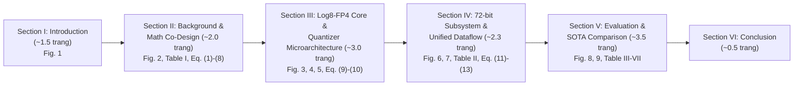

# Bản Thiết Kế Hoàn Chỉnh Paper IEEE TCAD / IEEE TVLSI: End-to-End 72-bit `Log8-FP4` Edge LLM Accelerator Subsystem

Tài liệu này là **bản thiết kế tổng thể (Master Paper Blueprint)** hoàn chỉnh cho bài báo gửi **IEEE TCAD** hoặc **IEEE TVLSI**, được tổng hợp trực tiếp từ toàn bộ mã nguồn RTL, testbench, kết quả đánh giá thuật toán và báo cáo tổng hợp ASIC trong workspace:
- Phân hệ RTL cốt lõi: [01_snax_llm_fp4_subsystem](file:///c:/Users/nguyen/Desktop/NPU_LOG/01_snax_llm_fp4_subsystem) (bao gồm [ARCHITECTURE_AND_SIM_REPORT.md](file:///c:/Users/nguyen/Desktop/NPU_LOG/01_snax_llm_fp4_subsystem/ARCHITECTURE_AND_SIM_REPORT.md), [FUSED_CORE_ARCHITECTURE.md](file:///c:/Users/nguyen/Desktop/NPU_LOG/01_snax_llm_fp4_subsystem/FUSED_CORE_ARCHITECTURE.md), [SFU_OPTIMIZATION_REPORT.md](file:///c:/Users/nguyen/Desktop/NPU_LOG/01_snax_llm_fp4_subsystem/SFU_OPTIMIZATION_REPORT.md), [GEMM_SEQUENCER_REDESIGN_SPEC.md](file:///c:/Users/nguyen/Desktop/NPU_LOG/01_snax_llm_fp4_subsystem/GEMM_SEQUENCER_REDESIGN_SPEC.md), [FLASHATTENTION_ALGORITHM_AND_SEQUENCER_SPEC.md](file:///c:/Users/nguyen/Desktop/NPU_LOG/01_snax_llm_fp4_subsystem/FLASHATTENTION_ALGORITHM_AND_SEQUENCER_SPEC.md), [UNIFIED_SEQUENCER_READBACK_DMAWB_ANALYSIS.md](file:///c:/Users/nguyen/Desktop/NPU_LOG/01_snax_llm_fp4_subsystem/UNIFIED_SEQUENCER_READBACK_DMAWB_ANALYSIS.md))
- Đánh giá thuật toán PyTorch bit-exact: [02_eval_llm_edge](file:///c:/Users/nguyen/Desktop/NPU_LOG/02_eval_llm_edge) ([eval_NousResearch_Llama-3.2-1B.csv](file:///c:/Users/nguyen/Desktop/NPU_LOG/02_eval_llm_edge/eval_NousResearch_Llama-3.2-1B.csv), [eval_Qwen_Qwen2.5-0.5B.csv](file:///c:/Users/nguyen/Desktop/NPU_LOG/02_eval_llm_edge/eval_Qwen_Qwen2.5-0.5B.csv), [result_ppl.md](file:///c:/Users/nguyen/Desktop/NPU_LOG/result_ppl.md))
- Đối chứng 7nm ASIC & 28nm Baseline: [04_ablation_rtl/ABLATION_ANALYSIS_REPORT.md](file:///c:/Users/nguyen/Desktop/NPU_LOG/04_ablation_rtl/ABLATION_ANALYSIS_REPORT.md) và [03_baselines/MiX-main](file:///c:/Users/nguyen/Desktop/NPU_LOG/03_baselines/MiX-main/hardware_rtl/results_28nm_iso512.csv)
- Kiểm chứng End-to-End LLM Layer: [LLAMA3_1B_PREFILL_REPORT.md](file:///c:/Users/nguyen/Desktop/NPU_LOG/LLAMA3_1B_PREFILL_REPORT.md) và [tb](file:///c:/Users/nguyen/Desktop/NPU_LOG/tb)
- Đối chiếu với các công trình SOTA quốc tế (2021–2026) từ **ISSCC, JSSC, ISCA, MICRO, HPCA, DAC, DATE, ASP-DAC, ISVLSI** (bao gồm cả tài liệu local và kết quả rà soát SOTA quốc tế mở rộng).

---

# PHẦN 1: PHÂN TÍCH TỔNG THỂ KIẾN TRÚC NGHIÊN CỨU HIỆN TẠI

## 1.1. Ba trụ cột Kiến trúc Cốt lõi & Khối phụ trợ Hệ thống đã hoàn chỉnh

Nghiên cứu của bạn xây dựng một hệ thống **Algorithm–Architecture–Circuit Co-Design** chạy trọn vẹn suy luận Edge LLM (1B–3B tham số) ở định dạng **4-bit toàn diện (`W4A4KV4` + Quantized Attention $P$)** trên **3 trụ cột phần cứng cốt lõi** kèm **1 khối phụ trợ hệ thống** khớp nhau 1-1:

1. **Định dạng 72-bit `Log8-FP4` & Bộ lượng tử hóa động Không Phép Chia ([slq_encoder.sv](file:///c:/Users/nguyen/Desktop/NPU_LOG/01_snax_llm_fp4_subsystem/slq_encoder.sv)):**
   - Mỗi khối $B=16$ phần tử được đóng gói thành đúng **1 word 72-bit**: `{scale_log8[7:0], 16×E2M1[63:0]}` (**4.50 bits/element**, bằng đúng effective bit-width của `NVFP4` và `MXFP4_g16` nhưng không cần FP32 tensor-level scale).
   - `scale_log8` là số nguyên có dấu 8-bit (`S4.3`), mã hóa lũy thừa phân số $2^{e/8}$ ($e \in [-128, 127]$), thu hẹp bước nhảy từ 1 octave ($2\times$ ở `MXFP4`) xuống $1/8$ octave ($2^{1/8} \approx 1.0905\times$).
   - Mạch lượng tử hóa trực tuyến **Subtractive Log-Quantizer (`slq_encoder`)** bỏ hoàn toàn việc tìm `max(|x|)/6.0` và phép chia/nhân nghịch đảo FP16 của `NVFP4`: ghép dây trực tiếp $\mu_i = \{E_{\text{fp16}}[4:0], M_{\text{fp16}}[9:7]\}$ (xấp xỉ logarit Mitchell bậc nhất với **0 cổng logic**), tìm $\mu_{\max}$ qua cây so sánh 8-bit 4 tầng, tính scale $\mu_{\max} - 140$, và mã hóa từng phần tử thành `E2M1` bằng phép trừ 8-bit $\text{diff}_i = \mu_{\max} - \mu_i$ so với 7 ngưỡng cố định `{2, 6, 10, 14, 18, 24, 36}` qua pipeline 2 tầng hỗ trợ backpressure (`pipe_advance = !out_valid || out_ready`).

2. **Lõi tính toán hợp nhất 7 khối ([snax_fused_llm_core.sv](file:///c:/Users/nguyen/Desktop/NPU_LOG/01_snax_llm_fp4_subsystem/snax_fused_llm_core.sv), 256 MACs/cycle @ 500 MHz):**
   - **`u_mac_array` ([log8_fp4_mac_array.sv](file:///c:/Users/nguyen/Desktop/NPU_LOG/01_snax_llm_fp4_subsystem/log8_fp4_mac_array.sv) + [log8_fp4_arith_units.sv](file:///c:/Users/nguyen/Desktop/NPU_LOG/01_snax_llm_fp4_subsystem/log8_fp4_arith_units.sv)):** Gồm 16 lanes $\times$ 16 phần tử (`256 MACs/cycle`). Stage 1A chạy song song `dot_product_16` (`fp4_mult_lut` + cây `compressor_4to2` ra tổng Q2 13-bit) và `scale_adder` ($e_A + e_W = 8q + r$). Stage 1B dùng **`logscale_frac_scaler` (3-term CSD Zero-Negator)** nhân phần dư $2^{r/8} \approx m_r/32$ ($m_r \in \{32, 35, 38, 41, 46, 49, 54, 59\}$) chỉ bằng **1 tầng 3:2 CSA 19-bit** (nhét `sub_t1`, `sub_t2` vào carry-in thay cho bộ bù 2 riêng) nối tiếp `bidirectional_shifter` căn chỉnh sang điểm tĩnh `Q16.16` 32-bit. Stage 2 cộng bão hòa 32-bit (`accum_adder`).
   - **`u_acc_buffer` ([rmw_latch_acc_buffer.sv](file:///c:/Users/nguyen/Desktop/NPU_LOG/01_snax_llm_fp4_subsystem/rmw_latch_acc_buffer.sv) + [latch_array.sv](file:///c:/Users/nguyen/Desktop/NPU_LOG/01_snax_llm_fp4_subsystem/latch_array.sv)):** Bộ đệm tích lũy 1W2R (`ACC_DEPTH_P = 16`, 8 Kbit) hiện thực bằng **Clock-Gated D-Latch** (`DHLx2_ASAP7_75t_R` + `ICGx4_ASAP7_75t_R`, nhóm 32 tải/ICG để giữ $C_{\text{load}} = 15.2\text{ fF} \ll 92.16\text{ fF}$). Tích hợp mặt nạ xóa ảo `slot_cleared` (0 chu kỳ xóa) và bypass cùng slot Stage-2 (`drain_word_comb`) trên Port B. Trong FlashAttention, 16 slots chẻ đôi cứng: `Slots 0..7` giữ $O$, `Slots 8..15` giữ $S = QK^T$.
   - **`u_softmax_requantizer` ([softmax_requantizer.sv](file:///c:/Users/nguyen/Desktop/NPU_LOG/01_snax_llm_fp4_subsystem/softmax_requantizer.sv)):** Trước khi vào Softmax, điểm $S$ được cô lập toán hạng (`sm_in_valid`) và nhân với hằng số **7-term CSD `LOG2E_Q16 = 94548`** ($2^{16}+2^{15}-2^{12}+2^8+2^6+2^4+2^2$, không dùng multiplier). Lợi dụng sự triệt tiêu đại số hoàn toàn của cả running max $m$ và mẫu số $l$ khi lượng tử hóa $P$ sang `Log8-FP4`, mạch sinh trực tiếp gói $P$ 72-bit chỉ bằng phép trừ nguyên $d_t = s'_{\text{bmax}} - s'_t$ và 7 ngưỡng cố định (`TH_6P0..TH_0P5`, Latency 1 cập nhật `m_q`, Latency 2 xuất $P$ + `l_contrib_out`, **0 LUT $2^x$, 0 phép chia trên $P$**).
   - **`u_p_fifo` ([p_fifo.sv](file:///c:/Users/nguyen/Desktop/NPU_LOG/01_snax_llm_fp4_subsystem/p_fifo.sv)) & `u_attn_rescaler` ([attn_o_rescaler_bank.sv](file:///c:/Users/nguyen/Desktop/NPU_LOG/01_snax_llm_fp4_subsystem/attn_o_rescaler_bank.sv)):** Hàng đợi on-chip transient giữ trọn các gói $P$ 72-bit kèm **sideband rescale 12+QW bit** (`{query_idx, resc_valid, resc_q[7:0], resc_r[2:0]}`), giúp $S$ và $P$ **không bao giờ chạm ra TCDM/DRAM**. Khi pha $P \times V$ (`cfg_mode = 2'b10`) pop gói $P$, sideband trễ 2 nhịp đồng bộ vào Stage 2 để 16 bộ `vsq_rescaler_32b` (cô lập toán hạng qua `gated_old_res`) rescale $O$ đúng chu kỳ tiêu thụ (*Consume-Time Deferred $O$-Rescaling*, 0 chu kỳ stall).
   - **`u_l_accumulator` ([l_accumulator.sv](file:///c:/Users/nguyen/Desktop/NPU_LOG/01_snax_llm_fp4_subsystem/l_accumulator.sv)) & `u_final_normalizer` ([final_normalizer.sv](file:///c:/Users/nguyen/Desktop/NPU_LOG/01_snax_llm_fp4_subsystem/final_normalizer.sv)):** Dùng chung duy nhất 1 bộ 31-bit LZC + 32-entry LUT `recip_lut` để sinh $1/l$ đúng 1 lần ở cuối hàng cho `O`, hợp nhất cả GEMM drain (`bypass_inv_l = 1`, cô lập 16 bộ nhân $32\text{b}\times 16\text{b}$) lẫn Attention $O$-drain (`bypass_inv_l = 0`) qua cùng khối `logscale_lazy_drain_norm` ngoài vòng lặp RMW.

3. **Hạ tầng Bộ nhớ 72-bit Native TCDM, Crossbar 25 Masters, Gearbox DMA, In-Flight V-Transpose & 4D Write-Out ([snax_llm_top_clean.sv](file:///c:/Users/nguyen/Desktop/NPU_LOG/01_snax_llm_fp4_subsystem/snax_llm_top_clean.sv), [multi_bank_tcdm_72b.sv](file:///c:/Users/nguyen/Desktop/NPU_LOG/01_snax_llm_fp4_subsystem/multi_bank_tcdm_72b.sv), [snax_simple_dma.sv](file:///c:/Users/nguyen/Desktop/NPU_LOG/01_snax_llm_fp4_subsystem/snax_simple_dma.sv), [snax_transpose_buffer.sv](file:///c:/Users/nguyen/Desktop/NPU_LOG/01_snax_llm_fp4_subsystem/snax_transpose_buffer.sv), [snax_streamer_write_out.sv](file:///c:/Users/nguyen/Desktop/NPU_LOG/01_snax_llm_fp4_subsystem/snax_streamer_write_out.sv)):**
   - **TCDM 288 KB (32 banks $\times$ 1024 words $\times$ 72-bit):** Cho phép nạp song song 1 gói Activation (`M2`) + 16 gói Weight/KV (`M3..M18`) = **1,224 bits/cycle** trong 1 chu kỳ với **0% phân mảnh scale** và **0 xung đột bank**.
   - **Gearbox DMA (`512b DRAM <-> 4 × 72b TCDM`):** Dùng buffer dịch `1,096-bit` khai thác tỷ số nguyên hoàn hảo $9\text{ beats} \times 512\text{b} = 64\text{ words} \times 72\text{b} = 576\text{ B}$ (`288 b/cycle = 36 B/cycle` ở chiều nạp).
   - **In-Flight 16×16 V-Transpose & 4D Write-Out (`MODE_FP4_4D`):** Chuyển vị trực tiếp $V$-tiles (`u_transpose_buffer`) sang layout `Log8-FP4` và tự động sắp xếp gói FP4 theo 4 chiều (`dim0..dim3`) trực tiếp xuống TCDM, xóa bỏ hoàn toàn CPU reorder.

4. **Khối phụ trợ hệ thống — Auxiliary In-Line Non-Linear Unit (`u_sfu`: [snax_llm_sfu_opt.sv](file:///c:/Users/nguyen/Desktop/NPU_LOG/01_snax_llm_fp4_subsystem/snax_llm_sfu_opt.sv), [snax_sfu_fp20_units.sv](file:///c:/Users/nguyen/Desktop/NPU_LOG/01_snax_llm_fp4_subsystem/snax_sfu_fp20_units.sv)):**
   - Đây là **khối kỹ thuật hỗ trợ cấp hệ thống** (system enabler, không đặt làm headline circuit contribution) giúp khép kín toàn bộ 1 Transformer layer trên phần cứng mà không đẩy `RMSNorm`, `RoPE`, `SwiGLU`, `Residual` về CPU host.
   - Dùng định dạng nội bộ **Custom FP20** (`8b exp + 11b mant`), chia sẻ `ALU_LANES = 8` qua 2 chunks (`4 cyc/vec`, khớp băng thông TCDM), **2-Pass Zero-Buffer RMSNorm** (xóa 65,536 FFs), và **PWL Sigmoid** (4 đoạn dịch exponent), nối giữa **`fused_fifo` (4-entry)** và **`u_log_quantizer`** để chạy liền mạch `Core -> fused_fifo -> SFU -> LogQ -> Write-Out`.

## 1.2. Định hướng đóng gói phần Sequencer đang hoàn thiện vào Paper

Trong quá trình phát triển RTL ([GEMM_SEQUENCER_REDESIGN_SPEC.md](file:///c:/Users/nguyen/Desktop/NPU_LOG/01_snax_llm_fp4_subsystem/GEMM_SEQUENCER_REDESIGN_SPEC.md), [FLASHATTENTION_ALGORITHM_AND_SEQUENCER_SPEC.md](file:///c:/Users/nguyen/Desktop/NPU_LOG/01_snax_llm_fp4_subsystem/FLASHATTENTION_ALGORITHM_AND_SEQUENCER_SPEC.md), [UNIFIED_SEQUENCER_READBACK_DMAWB_ANALYSIS.md](file:///c:/Users/nguyen/Desktop/NPU_LOG/01_snax_llm_fp4_subsystem/UNIFIED_SEQUENCER_READBACK_DMAWB_ANALYSIS.md)), bạn đã chỉ ra rằng việc duy trì 3 sequencer rời (`u_gemm_seq`, `u_seq`, `u_sfu_seq`) kèm các lệnh vá `Readback` và `DMA-WB` rời chỉ là trạng thái trung gian. **Trong bài báo IEEE TCAD / TVLSI, bạn cần trình bày thẳng kiến trúc Unified Credit-Driven Sequencer hoàn chỉnh:**
1. **4-Loop Output-Stationary GEMM Engine:** Vòng lặp `M_macro -> N_16 -> M_sub -> K_TILES`, giữ partial sum 100% trong 16-slot D-Latch, giữ credit Weight Ring qua hết `M_sub` tiles (giảm $M_{\text{sub}}\times$ băng thông đọc $W$) và gom ngưỡng **`CAP_O`** (bội của 4 tiles = 576 B = 9 DRAM beats) để xả Ping-Pong `O_buf0/1` ra DRAM.
2. **GQA-Aware KV-Pinned FlashAttention Engine:** Vòng lặp `h_kv -> h_grp -> q_base -> qi -> dvi -> kj`. Khi 1 KV-head $\le 144\text{ KB}$ ($N_{KV} \le 2,048$ với $d_k=64$), bật chế độ **KV-Pinning** nạp $K[h_{\text{kv}}]+V[h_{\text{kv}}]$ **đúng 1 lần** vào `Banks 0..15` cho toàn bộ $G$ query heads, toàn bộ $Q$-tiles và mọi $d_v$-slices; khi long-context $>144\text{ KB}$ tự động chuyển về 4-slot Ring streaming kèm Macro-DMA Ping-Pong `Q/O` trên `Banks 16..31`.
3. **In-Line SFU & Epilogue Controller:** Quản lý trực tiếp `Core -> fused_fifo -> SFU -> LogQ -> 4D WO` và `2-Pass RMSNorm -> LogQ`, gộp `Readback` thành chế độ `SFU_BYPASS -> LogQ` và đưa mọi luồng DRAM về **Shared 3-Tag Macro-DMA Arbiter** (`TAG_O_WB > Urgent TAG_IN > Prefetch TAG_W/KV`).
4. **Drain Pipeline Credit Guard (`inflight_out_cnt < 4`):** Bảo vệ đường ống xả 3 tầng (`acc_buffer -> final_normalizer S1 -> S2`) không bao giờ tràn 1-entry skid `out_hold_q` khi gặp backpressure từ `fused_fifo` hoặc `u_log_quantizer`.

---

# PHẦN 2: KEY CONTRIBUTIONS & ĐỐI CHIẾU VỚI CÁC NGHIÊN CỨU UY TÍN QUỐC TẾ

## 2.1. Đã có ai làm tương tự chưa? Bảng phân tích Research Gap so với SOTA Quốc tế (2021–2026)

Qua đối chiếu cả các tài liệu local lẫn tìm kiếm các công bố mới nhất trên **ISSCC, JSSC, ISCA, MICRO, HPCA, DAC, DATE, ASP-DAC, ISVLSI**, chưa có công trình nào giải quyết đồng bộ từ toán học lượng tử hóa `Log8-FP4` $\rightarrow$ mạch MAC không bộ nhân $\rightarrow$ Exp-Free FlashAttention triệt tiêu đại số $\rightarrow$ phân hệ SNAX 72-bit tích hợp khối phụ trợ SFU nội tuyến nhẹ như nghiên cứu của bạn:

| Nhóm công trình SOTA | Công trình tiêu biểu (Nơi công bố) | Cơ chế & Thông số phần cứng chính của họ | Khoảng trống (Research Gap) & Điểm vượt trội của chúng ta |
| :--- | :--- | :--- | :--- |
| **1. Microscaling (MX) & 4-bit LLM/VLM Accelerators** | **Cuyckens et al.** *(KU Leuven, ASP-DAC 2026, arXiv:2511.06313)* | Tích hợp mảng $8\times 8$ MX MAC hỗ trợ 6 chuẩn OCP (`MXINT8`, `MXFP8`, `MXFP6`, `MXFP4` với scale `E8M0`) vào SNAX bằng hybrid reduction tree; đạt `64–512 GOPS` và `~657–4,065 GOPS/W`. | Vẫn dùng scale `E8M0` (1 octave) chuẩn OCP nên **sụp đổ PPL ở 4-bit trên Edge LLM**, và **chỉ tăng tốc GEMM** (không có Log8 scale, không có FlashAttention hay FP20 SFU). |
| | **MiX** *(Liao & Seo, Cornell Tech, MICRO 2026)* | Đảo microscaling (per-element 3b exp + shared 3b mantissa) cho VLM. TSMC 28nm @ 500 MHz, 512/1024 MACs: `MiX-INT4_g16` (`56,125 µm²`, `31.8 mW`, `9.1 TOPS/mm²`, `16.1 TOPS/W`), `MiX-FP4_g16` (`65,458 µm²`, `37.1 mW`). Cần thêm `K-Smoother` (`6,258 µm²`, `1.8 mW`). | Trên text-only LLMs (Table VIII của `MiX`), `MiX-INT4_g16` thua `NVFP4` cả về PPL lẫn accuracy do thiếu mantissa per-element; vẫn cần scalar multiplier ở mỗi sub-tree + in-loop FP32 accumulator; **chưa tăng tốc Softmax/FlashAttention/SFU**. Của ta giữ `E2M1` khớp/vượt `NVFP4`, bỏ multiplier scale hoàn toàn và cắt `-25.4%` area, `-25.8%` power với D-Latch. |
| | **MX+** *(MICRO 2025)* & **AMXFP4** *(ACL 2025)* | `MX+` tái sử dụng exponent của Block-Max làm mantissa mở rộng; `AMXFP4` dùng 2 scale FP8 bất đối xứng (làm PE phình ~2$\times$ lên `115,380 µm²`, `4.4 TOPS/mm²` @ 28nm). | Chỉ cải tiến phép nhân block GEMM; chi phí PE của `AMXFP4` quá lớn còn `MX+` vẫn giữ 1 scale thô cho các phần tử còn lại và không giải quyết Attention Softmax hay SFU. |
| | **BitMoD** *(HPCA 2025)*, **M-ANT** *(HPCA 2025)*, **MicroScopiQ** *(ISCA 2025)*, **OliVe** *(ISCA 2023)* | `BitMoD` dùng mixture-of-datatypes (FP4/FP3) với bit-serial PE (TSMC 28nm @ 1 GHz: tile $8\times 8$ tốn `99,509 µm²`, `39.36 mW`). `MicroScopiQ` giữ outlier độ chính xác cao + pruning + NoC `ReCoN`. | `BitMoD` phải chịu độ trễ bit-serial nhiều chu kỳ; `MicroScopiQ` cần NoC bất quy tắc và multi-precision INT PEs; tất cả đều **bỏ ngỏ mạch Softmax, RoPE, RMSNorm, SwiGLU**. |
| | **VSQ** *(Keller et al., NVIDIA, IEEE JSSC 2023)* | TSMC 5nm, `0.153 mm²`, `141 KB` SRAM, 16 vector lanes $\times$ 64 elements `INT4-VSQ` + **Latch Array collector** + PPU base-2 approx softmax; `38.7–48.7 TOPS/W` @ 0.67V, `95.6 TOPS/W` @ 0.46V, `23.3 TOPS/mm²`. | `VSQ` vẫn cần **bộ nhân scale $8\text{b}\times 8\text{b}$ + $14\text{b}\times 8\text{b}$** trong mỗi lane, **bắt buộc phải chạy QAT** (5–20 epochs), thay GELU bằng ReLU, và chính tác giả thừa nhận thiếu bộ nhớ hệ thống/controller cho LayerNorm, Transpose, Residual. |
| **2. FlashAttention & Exp-Free / Approx. Softmax** | **Softermax** *(Stevens et al., DAC 2021)* | Base-2 online softmax dùng LUT `clut` nội suy $2^{\text{frac}}$ cho từng phần tử và chia $1/l$ cho toàn hàng $P$; `0.90x` area và `2.35x` energy efficiency vs FP16 baseline. | Vẫn cần LUT $2^{\text{frac}}$, vẫn phải nhân $1/l$ trên cả $N_{\text{seq}}$ phần tử $P$ (xuất INT8), và bỏ $\log_2 e$ nên **cần fine-tuning**. Thiết kế của ta **triệt tiêu cả LUT $2^x$ lẫn $1/l$ khi sinh $P$** và **100% Training-Free** nhờ `LOG2E_Q16`. |
| | **SoftEx** *(Belano, Tortorella, Benini, Conti et al., DATE 2025)* | 12nm @ 1.12 GHz, dùng xấp xỉ Schraudolph + đa thức bậc hai cho mantissa; diện tích **`0.039 mm²` (`39,000 µm²`)**, đạt `10.8x` speedup so với 8 lõi RISC-V, `1.34 TOPS/W` ViT @ 0.55V. | Riêng khối SoftEx đã lớn hơn toàn bộ lõi 256-MAC + D-Latch của chúng ta (`7,196 µm²` @ 7nm), vì vẫn phải tính hàm mũ và chuẩn hóa chia từng phần tử ở FP/fixed-point thay vì triệt tiêu đại số vào gói `Log8-FP4`. |
| | **ConSmax** *(IEEE/arXiv 2024)* | 16nm FinFET @ 1.25 GHz (`~800 µm²`, `0.2 mW`), bỏ max và bỏ tổng $\sum e^x$ bằng hằng số học được (differentiable normalization constants) + bitwidth-split LUT cho $\exp()$. | **Bắt buộc phải huấn luyện/fine-tuning** các tham số chuẩn hóa cố định cho từng mô hình và không áp dụng được trực tiếp kiểu Training-Free PTQ cho Edge LLM hiện đại. |
| | **ExpMul** *(Alexandridis et al., ISVLSI 2025)* & **SystolicAttention** *(2025)* & **FLASH-D** *(2025)* | `ExpMul` (28nm) gộp phép tính $e^x \cdot V$ giảm 28.8% area và 17.6% power so với FlashAttention FP rời; `SystolicAttention` nhét FlashAttention vào 1 mảng systolic; `FLASH-D` ẩn phép chia softmax. | Vẫn tính toán trên nền tảng dấu phẩy động/integer truyền thống mà chưa kết hợp được với đồng thiết kế `Log8-FP4` để đưa $P$ về dạng gói nén 4-bit không cần mạch hàm mũ và lưu trực tiếp trong `p_fifo`. |
| **3. RISC-V / SNAX Subsystems & Transformer SoCs** | **SNAX** *(IEEE 2025)*, **DataMaestro** *(2025)*, **OpenGeMM** *(ASP-DAC 2025)*, **Voltra** *(2026)* | Cụm Snitch/RISC-V với 32-bank $\times$ **64-bit** TCDM (`128–270 KB`), Data Streamers N-D AGU, prefetch & transposer. `Voltra` (16nm, `0.654 mm²`, `1.60 TOPS/W`, `1.25 TOPS/mm²`) chạy `LLaMA3.2-3B` Prefill ($M=256$) & Decode với `69.7%–100%` util. | Dùng TCDM **64-bit** (bị lệch biên với gói microscaling 72-bit) và chủ yếu chỉ tăng tốc **INT8 GEMM/Conv2D**; Attention ở `Voltra` vẫn là 2 GEMM rời ghi $S=QK^T$ ra SRAM, thiếu Exp-Free FlashAttention và thiếu SFU cho RoPE/RMSNorm/SwiGLU. |
| | **Ayaka** *(Qin et al., IEEE JSSC Oct. 2024)* & **Marsellus** *(Conti et al., IEEE JSSC Jan. 2024)* | `Ayaka` (28nm, `10.76 mm²`, `544 KB` SRAM, 4096 MACs INT8/INT16, low-rank estimation): `0.17–6.53 TOPS`, `2.22–49.7 TOPS/W`. `Marsellus` (22nm FDX, `2.42 mm²`, `128 KB`, 2–8b DNN): `12.4 TOPS/W` @ 2b, `0.74 TOPS/W` @ 8b. | `Ayaka` làm ở độ rộng 8b/16b (tốn gấp $2\times$–$4\times$ băng thông KV/weight so với 4.5b); `Marsellus` chủ yếu tối ưu cho CNN/TinyML chứ không có pipeline FlashAttention + RoPE + SwiGLU cho Generative Edge LLM. |

## 2.2. Bốn Đóng góp Cốt lõi (Key Contributions) của Paper

- **Contribution 1 (Co-Designed 72-bit `Log8-FP4` Format & Division-Free Online SLQ Encoder):** Đề xuất định dạng `Log8-FP4` (4.50 bit/elem) tận dụng đủ 8-bit có dấu `S4.3` (32 octaves) để bỏ hoàn toàn `FP32 global tensor scale` của `NVFP4` (`UE4M3` 7-bit không dấu, 15 octaves), giúp khắc phục triệt để sụp đổ PPL của `MXFP4_g16` ở cùng 4.50 bit (**giảm `39.3%–90.4%` PPL** so với `floor` và **`41.0%–57.6%`** so với `ceil` trên `Llama-3.2-1B`, `SmolLM2-1.7B`, `Qwen3-1.7B-Base`) ở chế độ **100% Training-Free PTQ**, đi kèm mạch **`slq_encoder`** không dùng bộ chia/nhân (`0-gate {E, M[9:7]}` + phép trừ 8-bit + 7 ngưỡng).
- **Contribution 2 (Multiplier-less 3-Term CSD MAC Array & 1W2R Clock-Gated D-Latch Accumulator):** Thiết kế mảng 256-MAC/cycle thay bộ nhân scale FP8 của `NVFP4` bằng bộ cộng mũ 8-bit + bộ co giãn **3-term CSD Zero-Negator** + **Lazy FP16 Drain Normalizer** ngoài vòng lặp + bộ tích lũy **1W2R D-Latch**. Trên ASAP7 7nm @ 500 MHz (Iso-Throughput), riêng `Log8` cắt **53.8% datapath area overhead** của `NVFP4` (`-10.0%` Datapath Area, `-7.3%` Real Power), và khi kết hợp `INT32 Lazy` + `D-Latch` giúp đạt **`-25.4%` Total Area (`7,195.67 µm²`)**, **`-25.8%` Real Power (`5.856 mW`)**, **`35.58 TOPS/mm²`**, **`43.72 TOPS/W`**, và **`Composite PE Efficiency = 1555.3`** (`1.81×` so với `NVFP4`, thậm chí nhỏ hơn `-16.7%` Area và tiết kiệm điện hơn cả `MXFP4`).
- **Contribution 3 (Training-Free Exp-Free FlashAttention with Algebraic Cancellation & Consume-Time $O$-Rescaling):** Chứng minh và hiện thực hóa mạch **`softmax_requantizer`** kèm CSD **`LOG2E_Q16 = 94548`**: triệt tiêu đại số $\exp()$, $m$ và mẫu số $l$ khi sinh $P$ 72-bit (`0 LUT 2^x, 0 bộ chia trên P`), kết hợp **`p_fifo` sideband** để trì hoãn rescale $O$ qua **`attn_o_rescaler_bank`** sang đúng nhịp tiêu thụ $P \times V$ (**0 chu kỳ stall, 0 byte traffic $S,P$ ra SRAM/DRAM**).
- **Contribution 4 (End-to-End 72-bit Native Subsystem with 4D Write-Out, Unified Sequencer & Lightweight In-Line SFU):** Nâng cấp kiến trúc SNAX với **288-KB 72-bit Native TCDM**, **Gearbox DMA `512b <-> 4×72b`**, **In-Flight 16×16 V-Transpose**, **4D Write-Out**, và **Unified 4-Loop/GQA KV-Pinned Sequencer**, đồng thời ghép nối một khối phụ trợ nội tuyến siêu nhẹ **`u_sfu`** (`ALU_LANES = 8`, Custom FP20, 0-FF RMSNorm, PWL SwiGLU) qua `fused_fifo` để khép kín toàn bộ pipeline `Core -> fused_fifo -> SFU -> LogQ -> 4D WO` không nghẽn host CPU RV32I. Hệ thống cắt **45.0% chu kỳ thực thi**, đạt **`85.1%` MAC utilization toàn layer** (`99.28%–99.65%` trên GEMM + DMA), giảm **`512×–4,096×`** lượt đọc DRAM cho $K$, và đạt **`37.74 dB` SQNR (`CosSim = 0.999916`)** trên dữ liệu thực `Llama-3.2-1B`.

---

# PHẦN 3: CẤU TRÚC CHI TIẾT BÀI BÁO IEEE TCAD / IEEE TVLSI (6 SECTIONS, 12–14 TRANG)

**Tiêu đề gợi ý (Title):**
> *"An End-to-End 72-bit Log8-FP4 Edge LLM Accelerator Subsystem With Algebraic-Cancellation Exp-Free FlashAttention and Multiplier-Less CSD MAC Array"*

**Định vị tạp chí:**
- **Nếu gửi IEEE TCAD:** Nhấn mạnh tính đồng thiết kế **Algorithm–Architecture–Dataflow Co-Design** (chứng minh toán học `Log8-FP4` + `Exp-Free Softmax`, phân tích không gian 4-Loop Tiling & GQA KV-Pinning, mô hình hóa xung đột crossbar 25-Master & Gearbox DMA ở Section II & IV).
- **Nếu gửi IEEE TVLSI:** Nhấn mạnh sâu **VLSI Microarchitecture & Circuit-Level PPA** (sơ đồ mạch 3-term CSD Zero-Negator, 1W2R Clock-Gated D-Latch `DHLx2`/`ICGx4`, Operand Isolation, `slq_encoder`, `softmax_requantizer`, SAIF power & breakdown 7nm ở Section III & V).



---

## 3.1. Section I: Introduction (~1.5 trang)
* **Nội dung & Lập luận từng đoạn:**
  1. *Bối cảnh:* Bùng nổ Edge LLM (0.5B–3B) bị kẹp giữa Memory Bandwidth Wall (trọng số + KV-cache) và Compute/Non-linear Wall (`QK^T`, Softmax `exp()`/`div`, `RMSNorm`, `RoPE`, `SwiGLU`).
  2. *Hạn chế của các giải pháp lượng tử hóa hiện hành:* Weight-only (W4A16) không nén KV-cache và giữ PE ở 16-bit; `MXFP4` (`E8M0`) sụp đổ độ chính xác trên Edge LLM; `NVFP4` (`E4M3`) và `VSQ` phải gánh bộ nhân scale trong mọi lane và bộ chia/nhân khi quantize; `MiX` bị hạn chế trên text-only LLM và bỏ ngỏ Attention/SFU.
  3. *Hạn chế của các bộ tăng tốc Attention & Subsystem:* `Softermax`/`SoftEx` vẫn phải tính hàm mũ $2^x$ và chia $1/l$ cho từng phần tử $P$; `ConSmax` đòi hỏi fine-tuning; các cụm `SNAX`/`OpenGeMM`/`Voltra` dùng TCDM 64-bit gây phân mảnh gói microscaling 72-bit và thiếu đường ống hợp nhất `Core -> SFU -> Quantizer`.
  4. *Tóm tắt 4 Key Contributions* (C1–C4) kèm số liệu định lượng nổi bật nhất.
* **Hình vẽ:**
  - **`Fig. 1` (Motivation & Architectural Comparison):**
    - *(a)* Biểu đồ cột đôi đối chiếu **WikiText-2 PPL** (`Qwen2.5-0.5B` & `Llama-3.2-1B`) và **PE Datapath Area** giữa `MXFP4`, `NVFP4`, và **`Log8-FP4 (Ours)`**.
    - *(b)* So sánh luồng thực thi End-to-End 1 Transformer Layer: *Unfused FP4 Baseline* (ghi/đọc $S, P$ và FP16 qua SRAM/DRAM, Softmax có `exp()` + `div`) vs. *Proposed Fused `Log8-FP4` Subsystem* (`0` traffic $S/P$, `0` `exp()`, Auxiliary In-Line SFU).

---

## 3.2. Section II: Background and Mathematical Co-Design (~2.0 trang)
* **Nội dung & Lập luận từng tiểu mục:**
  - **II-A. Định dạng 72-bit `Log8-FP4` (`{scale_log8[7:0], 16×E2M1[63:0]}`):** Giải thích cấu trúc 8-bit `S4.3` ($2^{e/8}$), tại sao bước nhảy $1/8$ octave triệt tiêu lỗi làm tròn của `E8M0` mà khớp 1 word SRAM 72-bit; đồng thời chỉ rõ từ kiểm chứng mã nguồn `NVFP4` của `MiX` (`UE4M3` 7-bit không dấu `[6:0]`, chỉ phủ 15 octaves nên *bắt buộc* phải có `FP32 global tensor_scale`), còn `Log8` dùng đủ 8-bit có dấu `[-128, 127]` (32 octaves) nên **bỏ được hoàn toàn `FP32 tensor_scale`**.
  - **II-B. Thuật toán Lượng tử hóa Động Không Phép Chia (`SLQ`):** Chứng minh cách ánh xạ IEEE FP16 sang logarit cơ số $2^{1/8}$ bằng nối dây 0-gate $\mu_i = \{E_i[4:0], M_i[9:7]\}$ (Mitchell piecewise-linear log approximation), trừ 8-bit `mu_max - 140` và lượng tử hóa qua 7 ngưỡng cố định. Phân tích đánh đổi độ chính xác: trên cùng 8-bit, `Log8` lý tưởng (`round(8*log2(max/6))`) đạt sai số đỉnh **`4.40%`** / trung bình `2.17%` (mịn hơn `NVFP4 UE4M3`: đỉnh **`5.86%`** / TB `2.25%`), còn `slq_encoder` đánh đổi lên `8.22%` / TB `3.15%` (`-2.24%` bias) để xóa 100% bộ nhân/chia và quét `FP32 amax` 2-pass; đồng thời nêu khả năng lượng tử hóa **Trọng số `W` tĩnh offline bằng `Exact Log8`** (`0` thay đổi RTL) trong khi Activation/KV dùng `slq_encoder` online.
  - **II-C. Chứng minh Toán học Exp-Free Base-2 Softmax & Sự Triệt tiêu Đại số:** Trình bày phép chuyển cơ số `LOG2E_Q16 = 94548`, chứng minh $m$ và $1/l$ tự triệt tiêu khi lượng tử hóa $P$, bất biến triệt tiêu `P_OFFSET = -21` và thừa số $2$ của $M_{\text{int}}$ ở $\hat{O}/\hat{l}$, và **luận điểm phản biện khẳng định**: *chỉ `Log8-FP4` mới làm được Exp-Free Softmax 100% không cần $2^x$ (vì `NVFP4` vẫn phải tính $2^x$ để đổi về dạng tuyến tính `E4M3`)*.
* **Các Công thức Toán (Eq. 1–8):**
  $$\hat{x}_i = (-1)^{s_i} \cdot \text{E2M1}(c_i) \cdot 2^{e_{\text{log8}} / 8}, \quad \text{E2M1}(c_i) \in \{0, 0.5, 1, 1.5, 2, 3, 4, 6\} \tag{1}$$
  $$y = \sum_{i=0}^{15} \hat{a}_i \hat{w}_i = 2^{q} \cdot 2^{r/8} \sum_{i=0}^{15} (-1)^{s_{a,i} \oplus s_{w,i}} \frac{M_{\text{int}}(c_{a,i}) M_{\text{int}}(c_{w,i})}{4} \approx 2^{q - 7} \cdot m_r \sum_{i=0}^{15} P_{\text{Q2}, i} \tag{2}$$
  $$\mu_i = \begin{cases} 0, & E_i = 0 \\ 247, & E_i = 31 \\ \{E_i[4:0], M_i[9:7]\}, & 0 < E_i < 31 \end{cases}, \qquad e_{\text{log8}} = \text{clamp}(\mu_{\max} - 140, -128, 127) \tag{3}$$
  $$\Delta \mu_i = \mu_{\max} - \mu_i, \qquad c_i = \sum_{k=1}^{7} \mathbb{I}(\Delta \mu_i \le \text{TH}_k) \tag{4}$$
  $$s'_t = s_t \cdot \log_2 e \approx s_t \cdot \frac{94548}{2^{16}} = \left(s_t \cdot (2^{16} + 2^{15} - 2^{12} + 2^8 + 2^6 + 2^4 + 2^2)\right) \gg 16 \tag{5}$$
  $$\frac{p_t}{S_{\text{blk}}} = \frac{2^{s'_t - m} / l}{2^{s'_{\text{bmax}} - m} / (6l)} = 6 \cdot 2^{-(s'_{\text{bmax}} - s'_t)} = 6 \cdot 2^{-d_t}, \quad d_t = s'_{\text{bmax}} - s'_t \ge 0 \tag{6}$$
  $$p_{\text{blk}} = \text{clamp}\!\left(\left\lfloor \frac{(s'_{\text{bmax}} - m_{\text{next}}) + 2^{12}}{2^{13}} \right\rfloor - 21, -128, 127\right) \le -21 \tag{7}$$
  $$\hat{l}_{\text{next}} = \hat{l}_{\text{curr}} \cdot 2^{m_{\text{curr}} - m_{\text{next}}} + 2^{p_{\text{blk}}/8} \sum_{t=0}^{15} M_{\text{int}}(c_{P,t}), \qquad O_{\text{final}} = \frac{\hat{O}_{\text{unnorm}}}{\hat{l}_{\text{total}}} = \frac{\sum_j (2 \cdot 2^{-21/8} P_j) V_j}{\sum_j (2 \cdot 2^{-21/8} \sum_t P_{j,t})} = \frac{\sum_j P_j V_j}{\sum_{j,t} P_{j,t}} \tag{8}$$
* **Hình vẽ & Bảng biểu:**
  - **`Fig. 2`:** So sánh cấu trúc bit-level giữa `OCP MXFP4`, `NVIDIA NVFP4` (kèm FP32 tensor scale), và **`Proposed 72-bit Log8-FP4`**, kèm đồ thị bước nhảy scale trên trục logarit.
  - **`Table I`:** Bảng tổng hợp hằng số phần cứng: (a) 8 mức `E2M1` & $M_{\text{int}}$, (b) 8 hệ số 3-term CSD $m_r \in \{32,35,38,41,46,49,54,59\}$ kèm tổ hợp dịch-cộng/trừ và sai số xấp xỉ, (c) 7 ngưỡng của `slq_encoder` (`8-bit`) và `softmax_requantizer` (`Q16.16`).

---

## 3.3. Section III: Proposed Log8-FP4 Core & Quantizer Microarchitecture (~3.0 trang)
* **Nội dung & Lập luận từng tiểu mục:**
  - **III-A. Kiến trúc 7 Khối Tách biệt của `snax_fused_llm_core`:** Trình bày nguyên tắc tách **Pure Compute (`log8_fp4_mac_array`)**, **Storage (`rmw_latch_acc_buffer`)**, và **FlashAttention Rescaler (`attn_o_rescaler_bank`)** để giữ đường tới hạn MAC cực ngắn và hợp nhất ngõ ra FP16 qua duy nhất 1 `final_normalizer`.
  - **III-B. Mạch MAC 3-Term CSD Zero-Negator & Bộ tích lũy 1W2R Clock-Gated D-Latch:** Phân tích chi tiết từng tầng pipeline `Stage 1A | Stage 1B | Stage 2`, kỹ thuật nhét bit trừ `sub_t1, sub_t2` vào 3:2 CSA, cấu trúc `ICGx4 + DHLx2` (nhóm 32 bits/ICG), mặt nạ xóa ảo `slot_cleared` 0 chu kỳ, và bypass cùng slot `drain_word_comb`.
  - **III-C. Mạch Exp-Free Softmax, Consume-Time $O$-Rescaling, Shared Reciprocal & Online `slq_encoder`:** Giải thích vòng phản hồi 1 chu kỳ của `m_q[query_idx]`, cơ chế đóng gói sideband rescale 12+QW bit vào `p_fifo` để tách rời Softmax khỏi `O-Rescaling`, cô lập toán hạng (`gated_old_res`, `mult_active`) tại `attn_o_rescaler_bank` và `final_normalizer`, bộ sinh $1/l$ dùng chung 1 LZC + 32-entry `recip_lut`, và bộ lượng tử hóa không phép chia **`slq_encoder`**.
* **Các Công thức Toán (Eq. 9–10):**
  $$\text{scaled\_prod} = \underbrace{(t_0 \oplus t_1 \oplus t_2)}_{\text{csa\_sum}} + \underbrace{\{(t_0 t_1 \lor t_1 t_2 \lor t_0 t_2)[W-2:0], \text{sub}_{t1}\}}_{\text{csa\_carry\_shifted}} + \text{sub}_{t2}, \quad t_k = \text{sub}_{tk} \,?\, \sim t_{k,\text{mag}} : t_{k,\text{mag}} \tag{9}$$
  $$\frac{1}{\hat{l}} \approx \text{LUT}\!\left[(\hat{l} \ll \text{lzc})[29:25]\right] \cdot 2^{\text{lzc} - 29}, \qquad E_{\text{fp16}} = 31 - \text{LZC}_{32}(|Y|) - \text{FRAC\_BITS} + 15 + c_{\text{rnd}} \tag{10}$$
* **Sơ đồ Khối & Mạch Logic (Figures 3–5):**
  - **`Fig. 3` (Block Diagram of 7-Block `snax_fused_llm_core`):** Toàn bộ 7 module, chỉ rõ phân hoạch `Slots 0..7 (O)` / `Slots 8..15 (S)`, đường dữ liệu `Mode 00/01/10`, và `p_fifo` loopback.
  - **`Fig. 4` (Logic Circuit of 1 MAC Lane & 1W2R Clock-Gated D-Latch Buffer):** *(a)* Chi tiết cổng/tầng của `dot_product_16`, `scale_adder`, `3-term CSD Zero-Negator` (`t0, t1, t2` $\rightarrow$ 3:2 CSA $\rightarrow$ CPA), `bidirectional_shifter`, `accum_adder`; *(b)* Cấu trúc `ICGx4 + DHLx2`, `slot_cleared` FF mask, `drain_word_comb` bypass mux, và cổng AND operand isolation.
  - **`Fig. 5` (Logic Circuit of `slq_encoder` & `softmax_requantizer` + `l_accumulator`):** *(a)* Mạch `slq_encoder` (ghép dây `{E, M[9:7]}`, cây max 8-bit, trừ 140, 16 bộ trừ + 7 ngưỡng); *(b)* Mạch `softmax_requantizer` (7-term CSD `LOG2E_Q16`, cây max 16-to-1, vòng 1-cycle `m_q`, 16 bộ trừ + 7 ngưỡng, khối tính $p_{\text{blk}}$ & `l_contrib`, và `l_accumulator` 1 shared LZC + 32-entry LUT).

---

## 3.4. Section IV: 72-bit Native Subsystem & Unified Dataflow Scheduling (~2.3 trang)
* **Nội dung & Lập luận từng tiểu mục:**
  - **IV-A. Kiến trúc `snax_llm_top_clean`: 72-bit Word-Aligned TCDM (288 KB), 25-Master Crossbar & Gearbox DMA:** Giải thích thiết kế word 72-bit (0% phân mảnh scale, nạp `1 + 16 = 17` words = `1,224 bits/cycle` zero bank-conflict), chia đôi vật lý `Banks 0..15` (Weight Ring / Pinned KV-Cache) và `Banks 16..31` (Ping-Pong `A/Q` & `O`), và Gearbox DMA `512b DRAM <-> 4×72b TCDM` (`BUF_W = 1,096` bits, $9 \text{ DRAM beats} = 64 \text{ TCDM words}$).
  - **IV-B. Luồng Dữ liệu Fused Epilogue, Auxiliary In-Line SFU, In-Flight V-Transpose & 4D Write-Out:** Trình bày ngắn gọn (~0.3 trang, ~12–15 dòng) khối **`u_sfu`** (`snax_llm_sfu_opt`) như một **Auxiliary In-Line Non-Linear Unit** cực nhẹ (`ALU_LANES = 8`, Custom FP20, 2-pass zero-buffer RMSNorm, PWL SwiGLU — không tốn chi phí mảng đệm 64 Kbit FF hay bộ nhân cho Sigmoid) đặt giữa **`fused_fifo` (4-entry)** và **`u_log_quantizer`** để loại bỏ nút cổ chai CPU host RV32I và tránh ghi/đọc FP16 trung gian qua TCDM (`Core -> fused_fifo -> SFU -> LogQ -> 4D WO`). Trình bày kèm đường offline Q/K weight permutation theo $(j, j+d_k/2)$, **`u_transpose_buffer`** (In-Flight 16×16 V-Transpose), và **`MODE_FP4_4D`** Write-Out sắp xếp trực tiếp tensor 4 chiều xuống TCDM.
  - **IV-C. Unified Credit-Driven Sequencer (`4-Loop OS GEMM` + `GQA KV-Pinned FlashAttention`):** Trình bày hai thuật toán tiling tối ưu băng thông DRAM, ngưỡng gom xả **`CAP_O`** (bội của 4 tiles = 576 B = 9 DRAM beats), chế độ **KV-Pinning** cho $N_{KV} \le 2,048$ (đọc $K, V$ đúng 1 lần), điều phối epilogue `Core -> fused_fifo -> SFU -> LogQ`, và **Drain Pipeline Credit Guard (`inflight_out_cnt < 4`)**.
* **Các Công thức Toán (Eq. 11–13):**
  $$\text{Addr}_{\text{TCDM}}(d_3, d_2, d_1, d_0) = \text{Base} + d_3 S_3 + d_2 S_2 + d_1 S_1 + d_0 S_0, \quad \text{Bank} = \text{Addr}[8:4], \; \text{Word} = \text{Addr}[18:9] \tag{11}$$
  $$2 \cdot \text{Size}(A_{\text{buf}}) + 2 \cdot \text{Size}(O_{\text{buf}}) \le 144\text{ KB}, \qquad \text{DRAM}_{\text{Read}}(W) = \frac{M_{\text{tiles}}}{M_{\text{sub}}} \cdot \text{Size}(W) \tag{12}$$
  $$\frac{\text{DRAM}_{\text{Read, Naive}}(K)}{\text{DRAM}_{\text{Read, KV-Pinned}}(K)} = G \times \left\lceil \frac{N_Q}{M_Q} \right\rceil \times \frac{d_v}{16}, \qquad \frac{\text{DRAM}_{\text{Read, Naive}}(V)}{\text{DRAM}_{\text{Read, KV-Pinned}}(V)} = G \times \left\lceil \frac{N_Q}{M_Q} \right\rceil \tag{13}$$
* **Hình vẽ & Bảng biểu:**
  - **`Fig. 6` (Subsystem Block Diagram & 288-KB TCDM Partition Map):** *(a)* Toàn phân hệ 25-Master Crossbar 72-bit, TCDM, Gearbox DMA, Streamers, Core, `fused_fifo`, khối phụ trợ SFU, Transpose, LogQ, 4D Write-Out, Unified Sequencer; *(b)* Bản đồ phân chia `Banks 0..15` vs. `Banks 16..31`.
  - **`Fig. 7` (End-to-End Transformer Layer Mapping & Pipeline Overlap Gantt Chart):** *(a)* Luồng 12 pha của 1 layer `Llama-3.2-1B`; *(b)* Biểu đồ Gantt thể hiện overlap giữa `Gearbox DMA Prefetch`, `Core MAC`, `In-Line SFU/LogQ`, và `Background O-Drain`.
  - **`Table II` (Quantitative Tiling & DRAM Reuse Comparison):** So sánh số lần đọc DRAM `A, W, Q, K, V` và spill $S/P/O$ trên TCDM 288 KB giữa `3-Loop Naive`, `Unfused Online Softmax`, và **`Proposed 4-Loop OS + GQA KV-Pinned`**.

---

## 3.5. Section V: Experimental Evaluation & SOTA Comparison (~3.5 trang)
*(Chi tiết đầy đủ nằm ở Phần 4 ngay bên dưới: 5 tiểu mục V-A đến V-E, `Fig. 8`–`Fig. 9`, `Table III`–`Table VII`).*

## 3.6. Section VI: Conclusion (~0.5 trang)
* Tóm tắt đóng góp cốt lõi trên cả 3 tầng (Format/Math, Circuit/PE, Subsystem/Dataflow) cùng các con số tổng kết tốt nhất về Accuracy, Area/Power Efficiency, và Full-Layer Utilization.

---

# PHẦN 4: THIẾT KẾ CHI TIẾT SECTION V — EVALUATION (PHƯƠNG PHÁP, THÍ NGHIỆM, SỐ LIỆU & SOTA)

Để đáp ứng chuẩn thẩm định khắt khe nhất của **IEEE TCAD / TVLSI**, Section V áp dụng **Phương pháp Đánh giá Phân tầng 5 Lớp (5-Tier Hierarchical Evaluation)** từ **V-A đến V-E**:

```text
V-A. Experimental Setup (3-Tier Toolchain & Edge LLM Workloads)
 │
 ├──► V-B. Algorithmic Accuracy & Bit-Exact RTL Numerical Verification
 │         (Chứng minh Log8-FP4 + Exp-Free Softmax không sụp đổ PPL & khớp 100% RTL)
 │
 ├──► V-C. Microarchitectural MAC & Accumulator Ablation (Iso-Throughput @ 7nm)
 │         (Tách biệt đóng góp của Log8 CSD vs. D-Latch & Cross-validate với 28nm)
 │
 ├──► V-D. Module-Level Overhead & Full Subsystem Breakdown
 │         (Chứng minh SLQ & Exp-Free Softmax siêu nhỏ; minh bạch Logic vs. 288KB SRAM)
 │
 └──► V-E. End-to-End Layer Performance, Memory Traffic & SOTA Comparison
           (Chứng minh Cycle Waterfall -45%, MAC Util 85.1%–99.65%, Traffic S/P=0, và SOTA Table)
```

---

## 4.1. V-A. Experimental Setup & Methodology (~0.4 trang)

1. **Tầng Thuật toán (`02_eval_llm_edge`):**
   - Bộ mô phỏng PyTorch/CUDA bit-exact khớp 100% logic RTL ([slq_encoder.sv](file:///c:/Users/nguyen/Desktop/NPU_LOG/01_snax_llm_fp4_subsystem/slq_encoder.sv), [softmax_requantizer.sv](file:///c:/Users/nguyen/Desktop/NPU_LOG/01_snax_llm_fp4_subsystem/softmax_requantizer.sv) với `LOG2E_Q16 = 94548`, `CSD_Q5`, và `V-Transpose` dọc trục token `N_KV`).
   - Đánh giá **100% Training-Free RTN PTQ** (`W4A4` Linear + `Q4/K4/V4` + `P4` không rotation/calibration) trên bộ **3 Edge LLM 1B–1.7B đa dạng họ kiến trúc**: `NousResearch/Llama-3.2-1B` (Meta), `HuggingFaceTB/SmolLM2-1.7B` (HuggingFace), và `Qwen/Qwen3-1.7B-Base` (Alibaba), trên **WikiText-2** và **C4** (`seq_len = 2048` chốt bản cuối; Zero-Shot `PIQA`, `HellaSwag`, `WinoGrande`, `ARC-E`, `ARC-C` là tùy chọn bổ sung). *(Không lấy `Qwen2.5-1.5B` làm benchmark chính do outlier `down_proj ~65,500` làm sập mọi phương pháp RTN kể cả `NVFP4 = 141.6`).*
2. **Tầng Mô phỏng Hệ thống RTL (`tb/`):**
   - **Siemens QuestaSim 2024.1** & **Verilator** cycle-accurate trên dữ liệu thực trích xuất từ Layer 1 `NousResearch/Llama-3.2-1B` (`34,209,792` bytes trọng số trên mô hình DRAM 512-bit, `DRAM_LATENCY = 6` cycles).
   - **Cơ sở chọn kích thước Workload Edge LLM ($M$):** Pha Decode dùng $M=1$; pha Prefill dùng Chunked Prefill $M \in \{16..256\}$ tokens — đúng chuẩn công nghiệp cho Edge NPU nhằm tránh tràn bộ nhớ và thermal throttling (trích dẫn **`llm.npu` [ASPLOS 2025]** chọn chunk $128/256$ trên Snapdragon NPU, **`Voltra` [arXiv 2026]** đánh giá `LLaMA3.2-3B` ở Prefill $M=256$ và Decode, cùng Qualcomm Genie SDK).
3. **Tầng Tổng hợp ASIC & Công suất Gate-Level SAIF (`04_ablation_rtl`):**
   - **Synopsys Design Compiler (`O-2018.06-SP1`, `compile_ultra`)** trên thư viện **ASAP7 7nm FinFET RVT TT (`PVT_0P7V_25C`)** tại **500 MHz (`2.0 ns`)** với strict timing closure (`Slack >= 0.00 ps`).
   - **Synopsys VCS (`O-2018.09-SP2`)** mô phỏng Gate-Level Netlist qua `4,000` chu kỳ để xuất file `.saif` đo công suất động/tĩnh chính xác bằng `dc_shell` / PrimeTime. Đối chiếu chéo với baseline RTL 28nm từ `MiX` ([results_28nm_iso512.csv](file:///c:/Users/nguyen/Desktop/NPU_LOG/03_baselines/MiX-main/hardware_rtl/results_28nm_iso512.csv)).

---

## 4.2. V-B. Algorithmic Accuracy & Bit-Exact RTL Verification (~0.7 trang)

* **Mục đích chứng minh:**
  1. Ở cùng ngân sách `4.50 b/elem` (`B=16`), `Log8-FP4` khắc phục hoàn toàn sụp đổ PPL của `MXFP4_g16` (cả `floor` lẫn `ceil`) và bám sát `NVFP4` dù bỏ hẳn `FP32 global scale`, bộ nhân `E4M3`, và nén thêm cả `P` xuống 4-bit.
  2. `3-term CSD` và `Exp-Free Softmax Requantizer` (`LOG2E_Q16`) hầu như không làm mất PPL (`100% Training-Free RTN PTQ`, không rotation/calibration).
  3. Toàn bộ RTL `snax_llm_top_clean` khớp chặt với mô hình phần mềm trên dữ liệu Layer 1 thực.
* **Bảng số liệu thực đo từ [TIER_A_EVAL_SUMMARY.md](file:///c:/Users/nguyen/Desktop/NPU_LOG/02_eval_llm_edge/TIER_A_EVAL_SUMMARY.md) (Colab T4 `16×1024`, `V-axis = token`, `--base_scale_mode log2e` — cần chạy chốt full `seq_len=2048, max_chunks=200` trước khi nộp):**

| Cấu hình | Scale / Softmax | Bit/elem | `Llama-3.2-1B` *(WT2 / C4)* | `SmolLM2-1.7B` *(WT2 / C4)* | `Qwen3-1.7B-Base` *(WT2 / C4)* |
| :--- | :--- | :---: | :---: | :---: | :---: |
| **`fp16`** | FP16 gốc | 16.00 | `10.377 / 13.081` | `8.397 / 12.042` | `9.511 / 14.499` |
| `mxfp4_g32_floor` | E8M0 floor (`B=32`, OCP v1.0) / FP32 | 4.25 | `56.887 / 68.809` | `115.322 / 120.244` | — |
| `mxfp4` | E8M0 ceil (`B=32`) / FP32 | 4.25 | `44.000 / 55.349` | `41.004 / 57.675` | — |
| **`mxfp4_g16_floor`** | E8M0 floor (`B=16`, OCP v1.0) / FP32 | **4.50** | `46.929 / 62.090` | `127.850 / 135.206` | `21.716 / 30.438` |
| **`mxfp4_g16_ceil`** | E8M0 ceil (`B=16`, MiX fix) / FP32 | **4.50** | `32.320 / 40.689` | `29.048 / 39.268` | `22.358 / 31.649` |
| **`nvfp4`** | FP32 + UE4M3 (`B=16`) / FP32 | **4.50** | `16.542 / 20.952` | `11.212 / 15.106` | `12.872 / 18.537` |
| `log8_fp4` | `slq_encoder`, exact $2^{s/8}$ (`B=16`) / FP32 | 4.50 | `17.696 / 22.597` | `12.576 / 16.701` | `12.996 / 19.319` |
| `log8_fp4_csd` | `slq_encoder` + **3-term CSD** / FP32 | 4.50 | `17.710 / 22.650` | `12.258 / 16.969` | `13.107 / 19.517` |
| **`log8_fp4_expfree` (Ours Full RTL)** | **3-term CSD + Exp-Free `P4` Softmax** | **4.50** | **`17.948 / 22.580`** | **`12.325 / 16.803`** | **`13.186 / 19.504`** |
| *Attention `O` vs. FP16 Softmax* | *(`L1 / Rel-L1 / CosSim`)* | — | *`0.0066 / 12.73% / 0.9796`* | *`0.0209 / 15.07% / 0.9170`* | *`0.1111 / 11.21% / 0.9783`* |

  - **Ghi chú mở rộng sub-1B (`Qwen2.5-0.5B`, full `2048`):** `FP16` (`13.070 / 20.052`), `MXFP4_g16_floor` (`546.743 / 846.284`), `MXFP4_g16_ceil` (`952.547 / 1194.457`), `NVFP4` (`33.137 / 52.037`), **`Log8-FP4 Full RTL`** (`51.675 / 108.397` — **tốt hơn `10.6×–18.4×`** so với `MXFP4_g16`, Attn `O CosSim = 0.985834`).
  - **RTL-to-Model Verification (viết gọn thành 1 đoạn 3–4 dòng ngay dưới `Table III`, KHÔNG tách thành bảng riêng theo đúng chuẩn `MiX` / `OpenGeMM` / `Voltra`):** Theo [TABLE_IV_VERIFICATION_REPORT.md](file:///c:/Users/nguyen/Desktop/NPU_LOG/tb/TABLE_IV_VERIFICATION_REPORT.md), chạy RTL nguyên bản trên Layer 1 thực `Llama-3.2-1B` đạt `0` lỗi (`2,374/2,374` checks ở `Chunked Prefill M=32, N_KV=128` và `165/165` ở `Decode M=1, N_KV=128`, `cpu_mem = 0`), đạt `CosSim = 0.995` (`Q/K`), `0.988` (`V`), và **`0.955–0.966` vs. FP32** (**`0.979–0.985` vs. PyFQ**) ở ngõ ra cuối toàn layer — bám sát mô hình phần mềm trong `±0.58 dB` (kể cả `<0.05 dB` từ SFU `FP20/PWL`). *(Giữ toàn bộ số liệu 8 stage trong [TABLE_IV_VERIFICATION_REPORT.md](file:///c:/Users/nguyen/Desktop/NPU_LOG/tb/TABLE_IV_VERIFICATION_REPORT.md) làm tài liệu dự phòng Rebuttal.)*
* **Bảng & Đồ thị:**
  - **`Table III`:** Chính là bảng PPL (`WikiText-2`, `C4`) ở trên trên `Llama-3.2-1B`, `SmolLM2-1.7B`, `Qwen3-1.7B-Base` *(kèm 1 câu trích `Attn O CosSim = 0.917–0.980` và đoạn ngắn RTL Verification ngay dưới bảng; cân nhắc chạy thêm biến thể `Offline Exact-Log8 W + SLQ A/KV` miễn phí 0 cổng logic, và Zero-Shot tasks nếu dư thời gian)*.
  - **`Fig. 8`:** Per-Block (`B=16`, `4.50 b/elem`) SQNR Analysis gồm 2 panel ([plot_per_block_sqnr.py](file:///c:/Users/nguyen/Desktop/NPU_LOG/02_eval_llm_edge/plot_per_block_sqnr.py)): *(a)* SQNR vs. Block Dynamic Range Ratio (`max|x|/mean|x|`) và *(b)* SQNR vs. Octave Phase Boundary (`log2(max|x|) mod 1`) có mốc $\phi = \log_2(1.5) \approx 0.585$ chỉ rõ 2 mặt lỗi `MXFP4 floor clipping` & `ceil scale-up`. *(Preview 10,496 blocks tại [fig8_per_block_sqnr.png](file:///c:/Users/nguyen/Desktop/NPU_LOG/02_eval_llm_edge/results/fig8_preview/fig8_per_block_sqnr.png): `Log8-FP4 CSD = 20.55 dB` sát `NVFP4 = 20.76 dB`, hơn `+4.90 dB` so với `MXFP4 floor` tại $\phi \approx 0.97$; bản chính thức chạy `--tensor_source activations` trên GPU).*

---

## 4.3. V-C. Microarchitectural MAC & Accumulator Ablation (Iso-Throughput 256 MACs/cycle @ 7nm) (~0.8 trang)

* **Mục đích chứng minh:** Tách bạch 3 đóng góp phần cứng độc lập qua thang bậc 5 bước (`C1`–`C5`): **`Log8-Scale CSD`** (`C3` vs. `C2`), **`INT32 Lazy Drain`** (`C4` vs. `C3`), và **`1W2R Clock-Gated D-Latch`** (`C5` vs. `C4`), đồng thời đối chiếu chéo tỷ lệ phần cứng với baseline **28nm của `MiX` (MICRO 2026)**.
* **Số liệu thực đo chuẩn từ [PAPER_ABLATION_RESULTS.md](file:///c:/Users/nguyen/Desktop/NPU_LOG/04_ablation_rtl/paper_syn/PAPER_ABLATION_RESULTS.md) (`ASAP7 7nm @ 500 MHz = 0.256 TOPS`, cùng cờ `compile_ultra -no_autoungroup`, `WNS >= 0.00 ps`, `TNS = 0.00 ps`, kích thích SAIF `Real Llama-3.2-1B` & `Uniform`):**

| Config (`256 MACs/cycle @ 500 MHz`) | Total Area ($\mu\text{m}^2$) | DP / Acc Area ($\mu\text{m}^2$) | Pwr Real / Unif (mW) | DP / Acc Pwr Real (mW) | Area Eff. ($\text{TOPS/mm}^2$) | Pwr Eff. ($\text{TOPS/W}$) | Composite Eff. |
| :--- | :---: | :---: | :---: | :---: | :---: | :---: | :---: |
| **`C1`: `MXFP4 + FP32 + FF`** | `8,642.54` | `4,415.79 / 4,226.76` | `5.932 / 7.225` | `4.508 / 1.424` | `29.62` | `43.16` | `1,278.3` |
| **`C2`: `NVFP4 + FP32 + FF`** | `9,643.20` | `5,424.14 / 4,219.06` | `7.893 / 8.530` | `6.081 / 1.812` | `26.55` | `32.43` | `861.0` |
| **`C3`: `Log8 + FP32 + FF`** | `9,105.60` | `4,881.73 / 4,223.87` | `7.316 / 8.013` | `5.580 / 1.736` | `28.11` | `34.99` | `983.8` |
| **`C4`: `Log8 + INT32 Lazy + FF`** | `7,892.84` | `3,776.35 / 4,116.49` | `6.397 / 6.525` | `4.183 / 2.214` | `32.43` | `40.02` | `1,298.0` |
| **`C5`: `Log8 + INT32 Lazy + D-Latch`** | **`7,195.67`** | **`3,768.64 / 3,427.03`** | **`5.856 / 5.982`** | **`4.084 / 1.772`** | **`35.58`** | **`43.72`** | **`1,555.3`** |

* **Mạch viết & Lập luận 4 bước trong Paper:**
  1. **Xác thực Baseline (`C2` vs. `C1`):** Trên cùng nền `FP32 + FF`, `NVFP4 (C2)` làm Datapath Area tăng **`+22.8%`** (`5,424.14` vs `4,415.79 µm²`) — **khớp gần như tuyệt đối với `+22.6%` trên TSMC 28nm của `MiX`**, khẳng định độ tin cậy của baseline tham chiếu.
  2. **Đóng góp thuần của `Log8-Scale` (`C3` vs. `C2`):** Thay bộ nhân scale `E4M3` bằng bộ cộng mũ 8-bit + 3-term CSD cắt **`53.8%`** phần datapath area overhead của `NVFP4` (`+465.94` vs `+1,008.35 µm²`), giảm **`-10.0%` Datapath Area** và **`-7.3%` Real Power** (`-8.2%` DP Power).
  3. **Đóng góp của `INT32 Lazy Drain` (`C4` vs. `C3`):** Đưa bộ chuẩn hóa FP32 ra khỏi vòng lặp RMW cắt sâu **`-22.6%` Datapath Area** (`4,881.73 -> 3,776.35 µm²`) và **`-25.0%` Datapath Power** (`5.580 -> 4.183 mW`), đồng thời mở khóa dịch bit 0-multiplier cho FlashAttention $O$-rescaling. *(Lưu ý 1 câu: `Acc Power` của `C4` tăng nhẹ `1.736 -> 2.214 mW` do bit dấu bù-2 INT32 `[31:16]` đảo khi tổng qua `0`, và được khử ngay ở `C5`.)*
  4. **Vai trò quyết định của `1W2R Clock-Gated D-Latch` (`C5` vs. `C4, C2, C1`):** Với `ACC_DEPTH = 16` (`47.6%–52.2%` tổng diện tích), thay FF bằng D-Latch (`C5`) cắt **`-16.7%` Acc Area** (`4,116.49 -> 3,427.03 µm²`) và **`-20.0%` Acc Power** (`2.214 -> 1.772 mW`). Chung cuộc, **`C5 (Ours)`** giảm **`-25.4%` Area, `-25.8%` Real Power (`1.81×` Composite Eff.: `1,555.3` vs `861.0`)** so với `NVFP4 (C2)`, và **nhỏ hơn `-16.7%` Area, tiết kiệm điện hơn cả `MXFP4 (C1)`**.
* **Bảng biểu (`V-C` không dùng hình riêng để tránh trùng lặp dữ liệu với bảng):**
  - **`Table IV`:** Chính là bảng 5-Config Iso-Throughput PE Ablation (`C1`–`C5`) ở trên *(kèm 2–3 câu đối chiếu `+22.8%` vs `+22.6%` với `MiX` 28nm ngay trong văn bản; bỏ `Fig. 9` trước đây để tiết kiệm ~0.35 trang và tránh lỗi redundant figure)*.

---

## 4.4. V-D. Module-Level Overhead & Full Subsystem Breakdown (~0.7 trang)

* **Mục đích chứng minh:**
  1. Chứng minh hai khối đặc trưng (`slq_encoder` và `softmax_requantizer`) nhỏ gọn vượt trội so với giải pháp `NVFP4`/`MiX` và các mạch Softmax SOTA (`Softermax`, `SoftEx`, `ConSmax`, `ExpMul`).
  2. Minh bạch hóa đóng góp diện tích & công suất của từng thành phần trong toàn bộ subsystem [snax_llm_top_clean.sv](file:///c:/Users/nguyen/Desktop/NPU_LOG/01_snax_llm_fp4_subsystem/snax_llm_top_clean.sv), tách bạch **Logic vs. 288-KB 72-bit TCDM SRAM** (theo đúng chuẩn `OpenGeMM`, `DataMaestro`, `MiX`), đồng thời định lượng chi phí cực nhỏ của khối phụ trợ `u_sfu`.
* **Các thí nghiệm & Bảng cần trình bày:**
  - **`Table V` (Microarchitectural Module-Level Comparison):**
    * **Phần A — Online Dynamic Quantizer:** `slq_encoder (Ours)` vs. [nvfp4_dyn_quantizer.sv](file:///c:/Users/nguyen/Desktop/NPU_LOG/01_snax_llm_fp4_subsystem/nvfp4_dyn_quantizer.sv) vs. [MiX_MX_Quantizer.sv](file:///c:/Users/nguyen/Desktop/NPU_LOG/03_baselines/MiX-main/hardware_rtl/src/quantizer/MiX_MX_Quantizer.sv) *(tổng hợp trên cùng ASAP7 7nm @ 500 MHz)*.
    * **Phần B — Hardware Softmax / Requantizer:** Đối chiếu `softmax_requantizer + LOG2E_Q16 CSD (Ours)` với `Standard LUT-Exp + Divider FP16 Softmax` (tự tổng hợp đối chứng 7nm) và số liệu công bố của **`Softermax` (DAC'21)** (`0.90x` FP16 area, `2.35x` energy eff., cần QAT), **`SoftEx` (DATE'25)** (`0.039 mm²` @ 12nm, dùng Schraudolph + poly), **`ConSmax` (2024)** (`800 µm²` @ 16nm nhưng bắt buộc train trước), và **`ExpMul` (ISVLSI'25)** (28nm FP).
  - **`Table VI` (Full Subsystem Area & Power Breakdown @ ASAP7 7nm, 500 MHz):** Tổng hợp toàn bộ `snax_llm_top_clean`, báo cáo từng khối (`u_mac_array`, `u_acc_buffer`, `u_attn_rescaler`, `u_softmax_req + p_fifo + l_acc`, `u_final_norm`, **`u_sfu (Auxiliary Non-Linear Unit — 1 dòng duy nhất để chứng minh hỗ trợ trọn vẹn hàm phi tuyến LLM chỉ tốn thêm X% diện tích hệ thống)`**, `u_log_quantizer + u_transpose_buffer`, `25×32 Interconnect + Streamers + Gearbox DMA + Sequencer`, và `288-KB 72-bit TCDM SRAM`).

---

## 4.5. V-E. End-to-End Performance, Memory Traffic & SOTA Comparison (~1.2 trang)

* **Mục đích chứng minh:**
  1. Chứng minh mức giảm chu kỳ tổng thể và hiệu suất khai thác phần cứng (MAC Utilization) trên mô hình thực nhờ tận dụng đường ống khép kín **`Core -> fused_fifo -> SFU -> LogQ`** (tránh nghẽn host CPU RV32I và tránh round-trip FP16 qua TCDM).
  2. Chứng minh mức giảm lưu lượng bộ nhớ TCDM và DRAM nhờ **Fused Pipeline** + **GQA KV-Pinning** + **72-bit Log8-FP4**.
  3. Đặt hệ thống lên bảng so sánh tổng thể với **8 kiến trúc SOTA quốc tế** và giải thích rõ cách quy đổi/đối chiếu công bằng.
* **Số liệu thực đo đã có trong repo:**
  - **Cycle Waterfall Optimization & End-to-End 1-Layer Execution** ([ARCHITECTURE_AND_SIM_REPORT.md](file:///c:/Users/nguyen/Desktop/NPU_LOG/01_snax_llm_fp4_subsystem/ARCHITECTURE_AND_SIM_REPORT.md#L126-L145)):
    * `Baseline` (chưa 4D WO): `197,388` cycles $\rightarrow$ `+ 4D Write-Out`: `194,348` cyc $\rightarrow$ `+ Fused Q/K-RoPE-LogQ + u_sfu_seq`: `120,390` cyc $\rightarrow$ `+ Direct Gate Staging`: `112,198` cyc $\rightarrow$ `+ Fused SwiGLU-LogQ`: **`106,936` cycles** (`HW Job = 32,919` cycles, **giảm `-45.0%` Wall Cycles** khi fuse `Core -> SFU -> LogQ`), đồng thời chạy trọn 19 bước thực trên Layer 1 `Llama-3.2-1B` đạt **`37.74 dB` SQNR (`CosSim = 0.999916`)**.
  - **Full-Layer `NousResearch/Llama-3.2-1B` Prefill** ([LLAMA3_1B_PREFILL_REPORT.md](file:///c:/Users/nguyen/Desktop/NPU_LOG/LLAMA3_1B_PREFILL_REPORT.md#L80-L99)):
    * Stream trọn vẹn `34,209,792` bytes (`534,528` beats 512-bit DRAM), **`111 passed, 0 failed`**.
    * Tổng chu kỳ: **`4,479,514` cycles**, trong đó `mac_active = 3,811,328` cycles (`85.1%` **Overall MAC Utilization toàn layer** so với trần lý thuyết `3,805,184` cycles); riêng các phép chiếu lớn đạt **`99.28%` (`GEMM O`)** và **`99.65%` (`GEMM Down` K-Tiling 2×4096)** — ẩn gần như 100% độ trễ DRAM!
  - **Memory Traffic Reduction** ([ATTENTION_COMPARISON_FLASH_VS_ONLINE_VS_NAIVE.md](file:///c:/Users/nguyen/Desktop/NPU_LOG/01_snax_llm_fp4_subsystem/ATTENTION_COMPARISON_FLASH_VS_ONLINE_VS_NAIVE.md)):
    * Tại $M=N_{KV}=1,024$ trên `Llama-3.2-1B`: xóa bỏ **`164–228 MB`** traffic trung gian $S, P$ (`64 MB` cho $S$ + `18 MB` cho $P$) xuống **`0 MB`**.
    * Khi bật **GQA KV-Pinning (`Banks 0..15`)** cho $N_{KV} \le 2,048$: giảm **`512×–4,096×`** lượng đọc lại $K$ từ DRAM.
* **Đồ thị & Bảng đối chiếu SOTA:**
  - **`Fig. 9`:** (a) Cycle Reduction Waterfall (`197k -> 106k`, và sau khi bật Unified Sequencer + DMA); (b) Per-Phase MAC Utilization trên `Llama-3.2-1B`; (c) On-Chip TCDM & Off-Chip DRAM Traffic Reduction (`FP16` vs. `Unfused FP4` vs. `Online-Softmax-Only` vs. `Proposed Fused Log8-FP4`).
  - **`Table VII` (So sánh toàn diện với 8 nghiên cứu SOTA Quốc tế):**

| Metric / Feature | **VSQ** [JSSC'23] | **Ayaka** [JSSC'24] | **OpenGeMM** [ASPDAC'25] | **BitMoD** [HPCA'25] | **SNAX-MX** [ASPDAC'26] | **Voltra** [arXiv'26] | **MiX** [MICRO'26] | **This Work** |
| :--- | :---: | :---: | :---: | :---: | :---: | :---: | :---: | :---: |
| **Tech Node** | 5 nm | 28 nm | 16 nm | 28 nm | 16 nm (SNAX) | 16 nm | 28 nm | **7 nm (ASAP7)** |
| **Freq. (MHz)** | 152–1760 | 85–430 | 200 | 1000 | — | 300–800 | 500 | **500** |
| **Target Models** | BERT, DeiT, CNN | Transformers | ViT, BERT, CNN | LLMs (W4/W3) | MX Kernels | LLaMA3.2, BERT | VLMs & LLMs | **Edge LLMs (LLaMA-3.2, Qwen2.5)** |
| **Data Format** | INT4-VSQ (4.13b) | INT8 / INT16 | INT8 (8b) | Mix FP4/FP3 | MXFP4..INT8 (`E8M0`) | INT8 (8b) | MiX-MX (4.25/4.5b) | **72b Log8-FP4 (4.5b W4A4KV4P4)** |
| **Training-Free?** | No (QAT) | Yes (Low-rank) | Yes (INT8) | Yes (PTQ) | Yes (OCP MX) | Yes (INT8) | Yes (K-Smoother) | **Yes (100% Training-Free PTQ)** |
| **Scale Hardware** | $8\times 8 + 14\times 8$ Mul | N/A | N/A | Bit-serial Dequant | Shift (`E8M0`) | N/A | Shift + Sub-tree Mul | **8b Add + 3-Term CSD (0 Mul)** |
| **Fused FlashAttn?** | No (PPU LUT $2^x$) | No | No | No | No | No (2 GEMMs) | No | **Yes (Algebraic Exp-Free + `p_fifo`)** |
| **On-Chip SFU?** | ReLU, Approx. SM | No (Host) | Quantizer only | No | No | Quant., MaxPool | Quant., K-Smoother | **Auxiliary FP20 (RMSNorm, RoPE, SwiGLU, Res.)** |
| **On-Chip SRAM** | 141 KB (264b) | 544 KB | 270 KB (64b) | 1,024 KB | Shared SPM | 134 KB (64b) | 704 KB | **288 KB Native 72b (32×1024×72b)** |
| **Throughput** | 2048 MAC/cyc | 4096 MAC/cyc | 512 MAC/cyc | 8×8 Bit-serial | 8×8 Hybrid MX | 512 MAC/cyc | 512 / 1024 MAC/cyc | **256 MAC/cyc (0.256 TOPS)** |
| **Sustained Util.** | 89%–99% | — | 81.9%–99.3% | — | — | 69.7%–97.3% | — (Cycle-sim) | **85.1% (Full Layer) / 99.7% (GEMM)** |
| **Compute Area** | $0.153\text{ mm}^2$ (Macro) | $10.76\text{ mm}^2$ (Chip) | $0.063\text{ mm}^2$ (Core) | $0.0995\text{ mm}^2$ (Tile) | — | $0.654\text{ mm}^2$ (Chip) | $0.056\text{–}0.130\text{ mm}^2$ | **`0.0072 mm²` (MAC+Latch) / `[X]` (Full)** |
| **Area Eff. ($\text{TOPS/mm}^2$)** | 23.3 (Macro) | 0.016–0.61 (Sys) | 3.25 (Core) | — | — | 1.25 (Sys) | 9.1 (Array 28nm) | **`35.58` (MAC+Latch) / `[X']` (Sys)** |
| **Energy Eff. ($\text{TOPS/W}$)** | 38.7–48.7 (0.67V) | 2.22–49.7 (Sys) | 35.5 (Core)/4.68 (Sys) | — | 4.07 (MXFP4) | 1.60 (Sys) | 16.1 (Array 28nm) | **`43.72` (MAC+Latch) / `[Y']` (Sys)** |

### Lưu ý khi so sánh số liệu với SOTA (Cách chặn bẻ của Reviewer về Technology Scaling):
- Các đối thủ nằm trên các nút công nghệ khác nhau (`5 nm` của `VSQ`, `7 nm` của ta, `16 nm` của `OpenGeMM`/`Voltra`/`SNAX-MX`, `28 nm` của `MiX`/`BitMoD`/`Ayaka`).
- Trong bài báo, luôn **ghi rõ node công nghệ gốc trong bảng** (tuyệt đối không gộp mập mờ), đồng thời sử dụng **công thức chuẩn hóa tỷ lệ kiến trúc (Iso-Node Cross-Validation)**: ví dụ đã chứng minh tỷ lệ tăng Datapath Area `+22.8%` của `NVFP4 vs. MXFP4` trên ASAP7 7nm của ta **khớp 1-1** với `+22.6%` trên TSMC 28nm của `MiX`, và cung cấp bảng quy đổi tham chiếu hoặc tổng hợp chéo `slq_encoder`/`softmax_requantizer` nếu cần.
- Về các thông số đánh giá tương đồng: `MiX` dùng **PPL + Zero-shot + Per-block SQNR vs. DR + Iso-throughput SAIF Area/Power + Composite PE Efficiency Pareto**; `OpenGeMM`/`DataMaestro`/`Voltra` dùng **Area/Power Breakdown tách TCDM SRAM vs. Logic + MAC Utilization (%) + LLaMA3.2 Prefill/Decode RTL Cycle Simulation**; `VSQ` dùng **Energy Breakdown (`Datapath` vs. `Buffers` vs. `Latch Collector`) + MAC Utilization + Task Accuracy**. Bộ số liệu của bạn **phủ trọn cả 3 chuẩn đánh giá này**.

---

# PHẦN 5: CHECKLIST HÀNH ĐỘNG CỤ THỂ TRƯỚC KHI HOÀN THIỆN BẢN THẢO

| Hạng mục | Trạng thái hiện tại | Việc cần làm tiếp theo |
| :--- | :--- | :--- |
| **1. `Table IV` (5-Config MAC Ablation `C1`–`C5`)** | **ĐÃ CHỐT SỐ LIỆU EDA (`PAPER_ABLATION_RESULTS.md`)** | Đã đồng nhất cờ `-no_autoungroup`, `WNS >= 0`, và SAIF `Real Llama-3.2-1B` + `Uniform`. *(Không cần vẽ hình riêng cho V-C).* |
| **2. `Table V` & `Table VI` (Module & Full Subsystem Breakdown)** | Đã có số liệu Core MAC và kiến trúc SFU `ALU_LANES=8` | Tổng hợp trên ASAP7 7nm @ 500 MHz cho: (a) toàn bộ [snax_llm_top_clean.sv](file:///c:/Users/nguyen/Desktop/NPU_LOG/01_snax_llm_fp4_subsystem/snax_llm_top_clean.sv) (điền các ô `[X]`, `[X']`, `[Y']` của `Table VI` & `Table VII`, trong đó **`u_sfu` chỉ báo cáo đúng 1 dòng trong `Table VI`**); (b) `slq_encoder` vs. `nvfp4_dyn_quantizer` vs. `MiX_MX_Quantizer` (`Table V-A`); (c) `softmax_requantizer` vs. LUT-Exp FP16 Softmax (`Table V-B`). *(Không cần tổng hợp lại bản cũ `snax_llm_sfu.sv`).* |
| **3. `Table III` & `Fig. 8` (Algorithmic Eval + RTL Verification)** | Đã hoàn thành RTL Verification (`TABLE_IV_VERIFICATION_REPORT.md`) + Preview `Fig. 8`; đã đo PPL `16×1024` trên 3 model | (a) Tối ưu VRAM `exp_free_softmax_requantizer` (`bucketize` + chunk `q_len=256`, sửa `rtl_ln2 -> 94548/65536`) và chạy chốt [eval_edge_llm.py](file:///c:/Users/nguyen/Desktop/NPU_LOG/02_eval_llm_edge/eval_edge_llm.py) full **`--seq_len 2048 --max_chunks 200`** trên `Llama-3.2-1B`, `SmolLM2-1.7B`, `Qwen3-1.7B-Base` (Zero-shot chạy sau nếu dư thời gian); (b) Chạy [plot_per_block_sqnr.py](file:///c:/Users/nguyen/Desktop/NPU_LOG/02_eval_llm_edge/plot_per_block_sqnr.py) với `--tensor_source activations` trên GPU cho `Fig. 8`. |
| **4. `Fig. 9` & `Table II` (Unified Sequencer End-to-End Cycles)** | Đã có `106,936` cyc (`tb_snax_llm_layer_fused`) và `4,479,514` cyc (`tb_llama3_1b_layer`) | Sau khi chốt Unified Sequencer (bỏ hẳn `Readback` & `DMA-WB` rời, bật `KV_Pin_En = 1` cho GQA), chạy lại `tb_llama3_1b_layer` (cả Decode $M=1$ và Chunked Prefill $M=16..256$) để cập nhật con số **Cycle Reduction** và **DRAM Beat Count** tối ưu nhất. |
